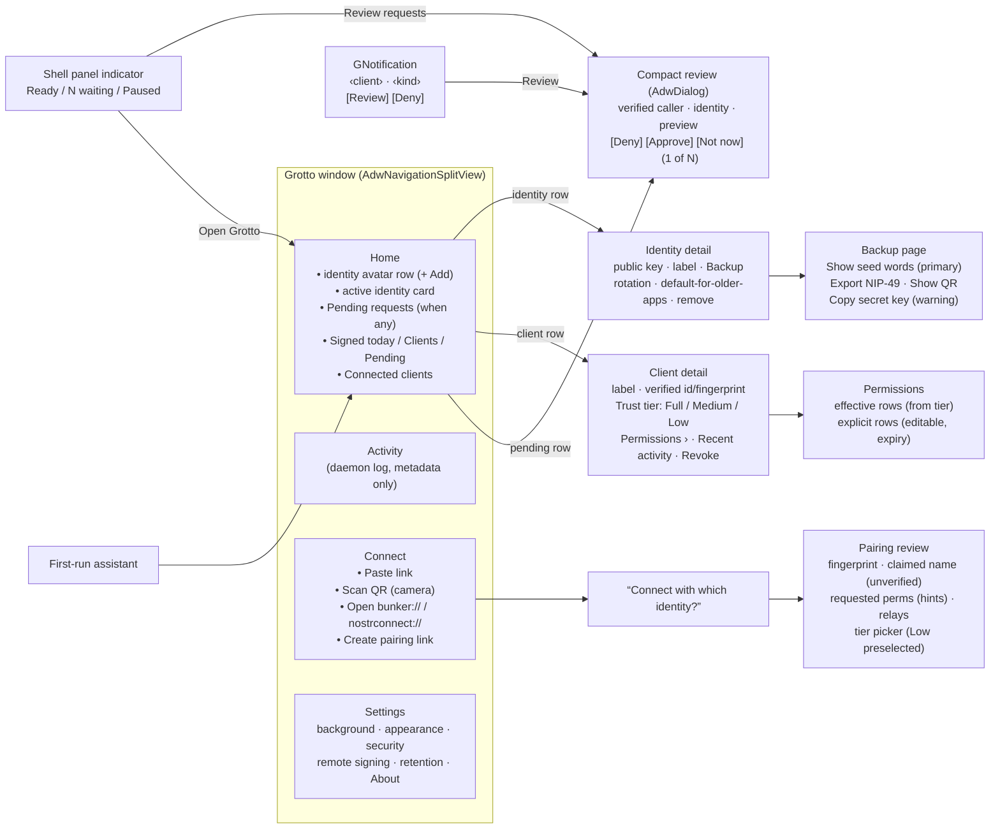
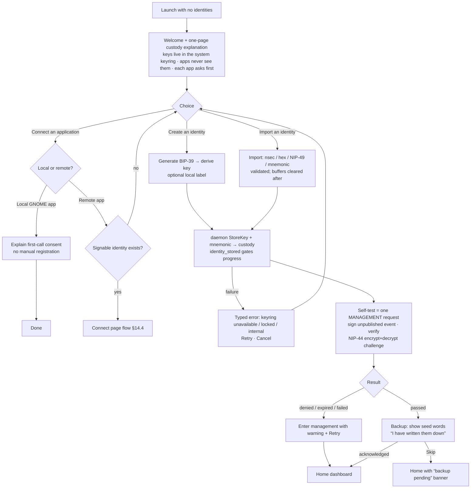
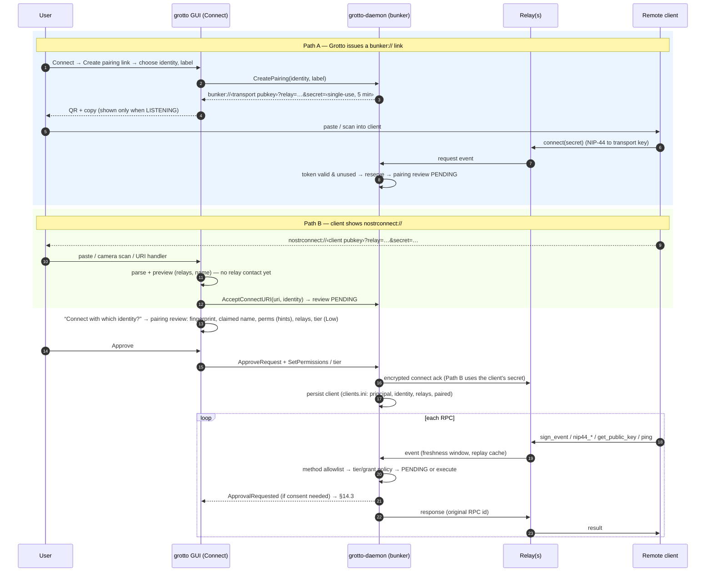
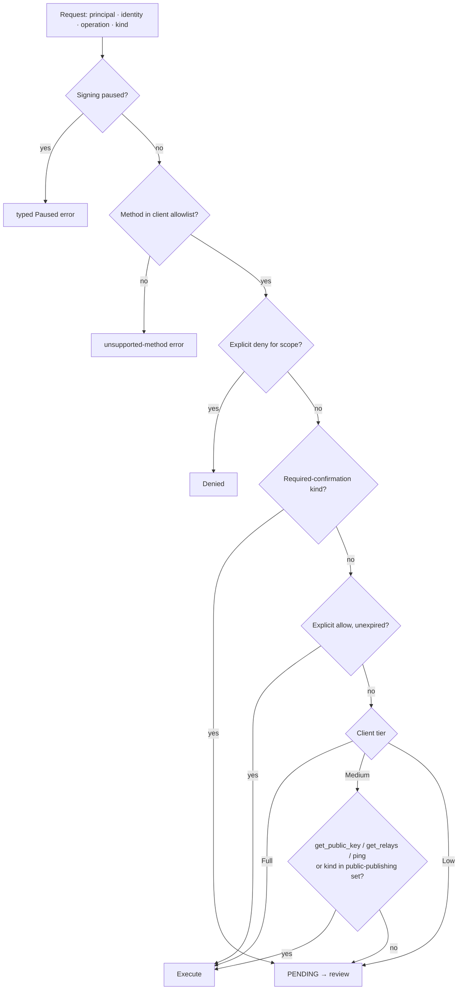
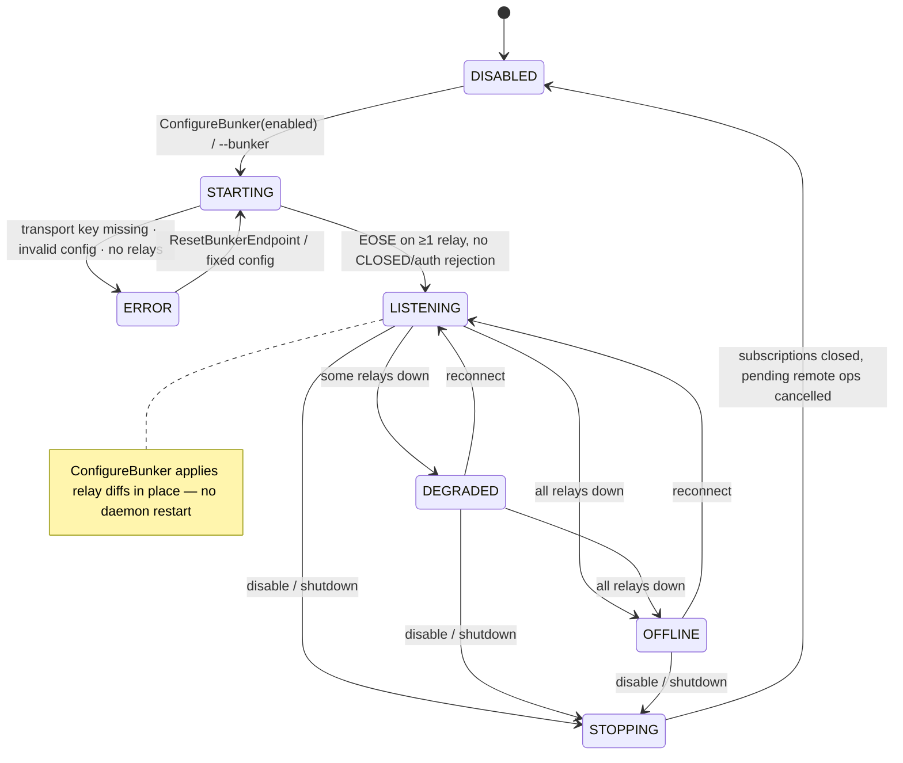
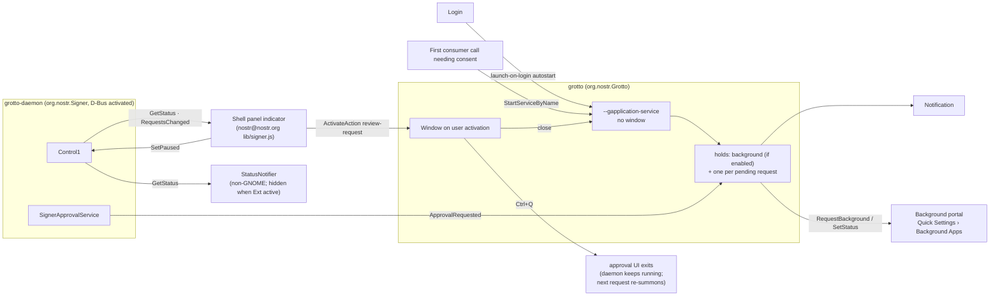

# Grotto Signer UX: Plan

Status: draft v2 (2026-10-12). v1 was authored hands-off; v2 folds in the owner's answers to the eight decision questions (§2) and the Clave/Amber screenshots (§6.3), and adds the Mermaid app-flow diagrams (§14).

## 1. Goal

Make Grotto (`apps/grotto`, app id `org.nostr.Grotto`) the premiere Nostr signer on Linux: the sovereign-identity centrepiece of the Nostr-on-GNOME/Ubuntu stack, **invisible by default** (surfaced only for onboarding, identity/account management, and explicit authorisation), deeply integrated with the GNOME session (D-Bus activation, notifications, Background portal, Secret Service), and still fully usable standalone as a simple NIP-46 bunker. Borrow proven patterns from Amber and Clave (§6).

## 2. Summary

Make Grotto a quiet, session-scoped identity service with three deliberate foreground experiences: identity setup/management, reviewing authorisation requests, and managing connected clients. Preserve `org.nostr.Signer`, `/org/nostr/signer`, `org.nostr.signer_bridge`, existing key-store identifiers, and one daemon per user session. Reuse the existing NIP-55L gate, key backend, grants, D-Bus activation and approval dialog; **refactor authorisation into one shared daemon-owned service so NIP-46 cannot bypass consent**. Deliver notification-first approvals, scoped (per-kind) permissions, honest locking/pause and activity states, and a *demonstrably functional* standalone bunker. Support native Debian/Ubuntu installation first; defer unwired hardware features, sandboxed-signer distribution, and a Shell extension.

Scope decision: a **bounded architectural refactor**, not a UI-only patch and not a rewrite. Refactor the gate/request lifecycle once; adapt all three transports (D-Bus, NIP-5F socket, NIP-46) to it; replace false session/history surfaces with daemon-backed models; retain existing widgets, crypto libraries, key backend, app ids and activation model. A dialog-only change cannot fix the remote-authorisation bypass, misleading locking, or cross-process state ownership.

### Owner decisions (confirmed 2026-10-12)

| ID | Decision | Rationale | Rejected alternative |
|---|---|---|---|
| **OC-1** ✅ | Notification-first approvals. The notification names the **client and the human kind** ("Jank · Contact list (kind 3)"), its buttons are **Review** and **Deny once** only — never Approve. Foreground requests enter the same inbox without stealing focus. | Owner choice between Clave-style (app + kind + Approve/Deny in the notification) and the generic v1 body: show who is asking, but approving still needs the preview. | Approve from the notification (Clave does this; rejected: one-tap approve with no content preview); generic body (rejected: hides who is asking). |
| **OC-2** ✅ (reversed) | **Ship a GNOME Shell panel indicator in v1** as part of the existing `gnome/nostr-shell-extension` (§5.12), *plus* Background-portal status and the opportunistic AppIndicator for non-GNOME. | Owner wants a panel presence on stock GNOME; the repo already maintains a Shell extension with D-Bus proxies (`lib/dm.js`, `lib/wallet.js`). | Extension-free v1 (v1 plan default); a *separate* Grotto extension (duplicate review/packaging burden). |
| **OC-3** ✅ | Hide hardware wallets, TPM/Secure Enclave, PKCS#11, multisig and NIP-26 delegation UI until each has an end-to-end tested signing/custody path, and keep them **absent from feature claims** (metainfo, README, desktop file; asserted by `signer/desktop-contract`). Hide **social recovery** too, for a different reason: it is wired and unit-tested (`page-settings.c:450`, `tests/test-social-recovery.c`) but its share creation/reconstruction + daemon-custody round-trip is untested end to end; unhide when that test exists. | Scout found the first group unwired (§4.4); advertising them is "fake completion". Owner confirmed "hide all until tested". | Wiring all of them now (XL scope, no demand evidence); keeping social recovery visible. |
| **OC-4** ✅ | Native Debian/Ubuntu (+ RPM/Arch/Nix) package is the supported distribution; Grotto Flatpak/AppImage remain experimental; Snap only on demand. | Caller identification uses host `/proc` and approver trust uses absolute path/inode; sandboxes break both (nostrc-mevv, nostrc-9z5w; `docs/designs/groundhog-packaging-plan-2026-10-05.md:169-178`). | Relaxing caller verification to pass a sandbox smoke. |
| **OC-5** ✅ | **Trust tiers per client, Clave-style — Full / Medium / Low — implemented as presets over the scoped per-kind permission model** (§5.4). New clients start at Low (ask every request). | Clave's client page (screenshot) shows exactly this and the owner chose it; the scoped model underneath keeps explicit grants/denies auditable and lets "Permissions" show what a tier actually allows. | Plan-v1 consent choices (Ask every time / Remember selected / Allow basic publishing) as the only model; a single global policy. |
| **OC-6** ✅ | **Clave-style Home dashboard is the default page**: identity avatar row with "+ Add", active-identity card, stat tiles (Signed today / Clients / Pending), pending requests at the top when any exist, Connected Clients list with trust badge + last seen. Navigation becomes **Home / Activity / Connect / Settings** (§5.1). | Owner choice; matches the "unobtrusive but one glance tells you everything" goal. | Requests-inbox-first with separate Identities/Applications pages (v1 default). |
| **OC-7** ✅ | **Backup: BIP-39 seed words are the primary backup; NIP-49 `ncryptsec` export is secondary; raw nsec copy/QR behind a warning.** No passphrase is asked at creation (the daemon never used it). The mnemonic is kept in daemon custody so "Show seed words" works later for identities created in Grotto (§5.7). | Amber's backup page shows seed words / copy secret / QR plus optional ncryptsec; owner picked seed-words-primary. | Amber-style password at creation producing an ncryptsec (rejected: duplicates keyring protection on first run); NIP-49-only (v1 default). |
| **OC-8** ✅ | **Camera QR scanning is a v1 requirement** for pairing (`sheet-qr-scanner.c` zbar + GStreamer path must be built by default on Linux and tested) alongside paste / file / `nostrconnect://` URI handler (§5.9). | Amber's "Add a new application" offers Paste / Scan QR / Add a nsecbunker; laptops have webcams. | Camera scan "only when built and tested" (v1 default). |
| **OC-9** ✅ | (a) The NIP-07 browser host sends its approval deadline (default 120 s) with the call so the daemon expires the request with it; (b) add a **Grotto component row** to `VERSION_MANIFEST.md` and version it as Preview 0.x (§8). | Owner confirmed both technical defaults. | Raising the host timeout to 300 s; keeping Grotto versionless under nip55l. |
| — | Consumers choose identities explicitly; a management selection never changes another consumer's identity. | One-Grotto-per-session owner decision (`apps/grotto/README.md:6-29`, commit `519bbf3e7`). | Global "active account" switch. |
| — | New clients start at **Low trust** (ask every request); there is no global "approve basic actions" policy — tiers are per client (OC-5). | Scoped per client (§5.4). | Global auto-approve-kinds (today's bunker bypass). |
| — | Background on by default; launch-on-login off. | Request-scoped D-Bus activation already works without a resident window. | Always-resident hidden window faking a tray. |
| — | Headless: explicit pre-approved permissions work with no GUI; anything needing consent fails closed with a typed protocol error. | Existing `NO_APPROVER` behaviour; Samba/greeter plans need bounded failure. | Hang or silent allow. |
| — | Post-login only: no authd IPC, PAM integration, greeter service or system-bus production mode. | `docs/plans/gnome-integration-and-samba-server-2026-09-25.md:598-613`. | — |

## 3. Background (curated evidence)

### 3.1 Product constraints (owner / docs)
- Rename is GNostr Signer → Grotto (not Signet; `signet/` is a separate headless fleet vault, `net.signet.Signer`). Keep: bus/interface `org.nostr.Signer`, object `/org/nostr/signer`, native host `org.nostr.signer_bridge`, legacy Secret Service/Keychain identifiers; GSettings reset once (`docs/designs/grotto-rename-plan-2026-10-05.md:3-24,41-55`). **One Grotto per user session, no `--instance`**; each consumer picks its identity (`apps/grotto/README.md:6-29`, commit `519bbf3e7`). Share stored identities, not active-account selection (`docs/plans/groundhog-gnome-messaging-2026-09-25.md:7-15`).
- Rename R3 (identity, "(preview)" labelling, About; nostrc-0ulk) and R4 (UX pass: onboarding, startup layout, approval dialog, macOS keychain) are open; **no dedicated Grotto UX plan exists** until this one. Grotto stays "Preview" until the UX pass lands (`docs/designs/groundhog-packaging-plan-2026-10-05.md:34-38,204-207`).
- Grotto is **not** the pre-login broker (`nostr-authd`, `/run/nostr-auth/*.sock`). The greeter QR login (`docs/designs/nip46-qr-login-greeter.md`) uses a *phone* signer; Grotto is post-login only (beads ot2c.6/ot2c.7/z1fb are not Grotto UX).
- Groundhog privacy charter: signer-side request reason is desired but absent; fail closed; honest "missing/locked/denied/timeout" states; onboarding self-test of one signature + one NIP-44 round-trip (`docs/designs/groundhog-privacy-ux-charter-2026-09-28.md:116,142,178,1089-1108`). `docs/plans/gnome-primitive-followups-2026-09-26.md:11`: kind-aware approvals, bind `app_id` to the real caller, round-trip remembered ACLs.
- Packaging: one `grotto` deb (GUI + daemon); Flatpak manifest `flatpak/org.nostr.Grotto.yaml` has never been built; AppImage waits; Snap only if asked (`docs/designs/groundhog-packaging-plan-2026-10-05.md:113-183`). Zapstore plan: maintainers sign releases through Grotto/NIP-46 (`docs/designs/zapstore-integration-2026-10-10.md:515-541`).
- Consumers all use the session bus `org.nostr.Signer`: gnostr (`apps/gnostr/src/ipc/signer_ipc.c`), Groundhog (`gnome/groundhog/src/identity/gh-signer-nip55l.c:7-19,332-359`, calls `EnableTypedApprovalErrors`, `SignEvent`, `NIP44Encrypt/Decrypt`, `NIP04Decrypt`), nostr-share, nostr-seal, nostr-settings, nostr-notify-daemon, libnostr-publish/nostr-dav, homed/FUSE (legacy fallback `com.nostr.Signer`), browser NIP-07 host. The GNOME Shell extension has no signer consumer.

### 3.2 Mockups (`assets/signer_mocks_{1,2,3}.png`, inspected)
Early pre-rename "Nostr/Gnostr Signer" concepts, non-GNOME-idiomatic (File/View/Help menubars, bespoke green/red buttons, bespoke header bars). Treated as a **content inventory**, mapped in §6.2. Screens: Welcome (Create/Import), Pending Signature Request (kind 4, From, Message, Approve/Deny, Details), Profile & Keys list (View Events, Manage Relays, Backup Keys, Change Password, Sign Message), Create Profile (display name, passphrase, recovery hint, "encrypt with hardware key"), Import (NIP-49 / mnemonic / hardware), Recent Events + Event Details (Copy ID, Show JSON), Manage Relays, Backup Keys (NIP-49 passphrase option), Change Password, Sign Message.

### 3.3 Current UI state (`apps/grotto/src/ui`, `data/ui/*.blp`)
- Lifecycle: `G_APPLICATION_DEFAULT_FLAGS` (+`NON_UNIQUE` if the 5 s session-bus probe fails) `main_app.c:1045-1049`; D-Bus-activated `grotto --gapplication-service` (`data/org.nostr.Grotto.service.in:3`) starts approval handling without a window (`main_app.c:757`); holds only while requests are pending (`:51`). Close destroys the window (`signer-window.c:109`); `start-minimized` GSetting unused (`gschema:197`, `settings_manager.c:446`). StatusNotifier indicator only where a watcher exists — nothing on stock GNOME (`main_app.c:~812`, `gn_status_notifier_new`; `gnome/common/gn-status-notifier.c:407`). `.desktop` advertises notifications (none are sent), URI handlers and `--new-identity/--settings` that `main_app.c:1045-1100` does not implement (`data/org.nostr.Grotto.desktop:13,20,30,34`).
- Main window: locked/unlocked `GtkStack`; `AdwNavigationSplitView` with five sections Permissions → Applications → Sessions → History → Settings (`signer-window.blp:36,89,288`); collapses at 800 px, bottom switcher < 500 px.
- Onboarding: `onboarding-assistant.c:1467` carousel (welcome, security, create/import, passphrase/import, seed, backup reminder, ready); skipping opens the main window.
- Approval: `approval_dialog.c:913` `AdwDialog`, presented immediately against the active window (or parentless); Deny focused first (`approval_dialog.c:~429`); operation-specific copy; "Remember" 10 min/1 h/24 h/Forever (default 10 min) applying to denials too; Escape denies without remembering; 305 s auto-close (`APPROVAL_EXPIRY_GRACE_S`, `main_app.c:325`). **No notification-first flow, no pending inbox, no per-kind chooser on the live path** (grants scoped requester+identity+operation string, `signer_grants.c:47`; per-kind client-session machinery has no live caller). Identity picker hidden (daemon resolves identity).
- Dormant (no launch path): `welcome-page`, `profile-dashboard`, `events-page`, `accounts_page`, `settings_page`, `home_page`, `hardware_keystore_widget`; sheets `account-backup`, `change-password`, `sign-message`, `event-details`, `delegation`, `hw-wallet`, `online-accounts`, `create-multisig`, `multisig-signing`, `create-account` (helper `signer-window.c:633` uncalled).
- Inert/broken: Permissions "Approval policy" radios + Orbot switch unbound (nostrc-7o76, `page-permissions.c:26`); Applications list has no model (`page-applications.c:36`, `page-applications.blp:62`); `sheet-add-application` only Cancel; `sheet-orbot-setup` Save unwired; Settings "Listen for new connections" only logs (`page-settings.c:635`); "Manage Sessions" activates nonexistent `win.show-sessions` (`page-settings.c:779`); session-expiry toast built but never shown (`signer-window.c:392`); duplicate History / Sign Policy dialogs (`page-settings.c:519,586`); jargon ("nsec_bunker", "Orbot", numeric "Kind").
- Deps: meson `libadwaita-1 >= 1.0`, `gtk4 >= 4.0`; CMake no floors; `GROTTO_VERSION` 1.0.0 (CMake) vs 0.1.0 (meson). Code already uses `AdwDialog` (1.5) (`approval_dialog.c:303`) → floors are stale.

### 3.4 Platform facts (web research, 2026-10; unverified items flagged)
- Ubuntu 24.04: libadwaita 1.5.0, GNOME Shell 46, xdg-desktop-portal 1.18.x, GTK 4.14. Ubuntu 26.04 (released 2026-04-23): libadwaita 1.9, Shell 50 (Wayland-only), portal 1.21. Upstream libadwaita 1.10. Since-versions: NavigationSplitView/ToolbarView/Breakpoint/SwitchRow 1.4; Dialog/AlertDialog/PreferencesDialog/AboutDialog 1.5; BottomSheet/ButtonRow/Spinner 1.6; ToggleGroup 1.7; ShortcutsDialog 1.8; Sidebar/ViewSwitcherSidebar 1.9.
- Background portal `org.freedesktop.portal.Background` v2: `RequestBackground` (autostart, commandline, dbus-activatable), `SetStatus` (≤96 chars, v2). Shell Quick Settings "Background Apps" (GNOME 44+) lists only portal-registered apps. Flatpak `commandline=flatpak run …` pitfall reported. *Unverified:* snapd Background-portal support.
- GNotification: default action + buttons must be `app.*` actions; priority (2.40), category (2.70); notifications persist beyond app exit and re-activate the app on click (the notification object won't exist then → route via actions). Notification portal v2 `display-hint` (transient/tray/persistent/hide-on-lock-screen/hide-content-on-lock-screen/show-as-new), `markup-body`. Shell fd.o daemon: actions, body, body-markup, persistence, sound; 3 urgency levels. *Unverified:* Shell 46 vs 50 `persistent` hint behaviour; GNOME 50 notification grouping.
- Secret portal v1 (per-app master secret; libsecret file backend in Flatpak); snap reaches it via `desktop` interface (core22+, libsecret ≥ 0.20.5); `password-manager-service` not auto-connected. GOA cannot hold arbitrary third-party credentials (not a key store). oo7 daemon is Fedora-targeted; Ubuntu unconfirmed.
- Shell extensions: ESM from GNOME 45, `shell-version` major-only, `PanelMenu.Button`; EGO forbids Gtk/Adw imports in the Shell process. Ubuntu ships the AppIndicator extension (no tooltips).

### 3.5 Test infrastructure and prior art
- Tests are CMake/ctest only (`apps/grotto/tests/CMakeLists.txt`; `ctest -R '^signer/'`; labels signer/ui/integration; convenience target `signer-tests`; `cmake/NostrcTestIsolation.cmake` gives private HOME/XDG). `signer/ui` (≈2,500 lines, `test-ui.c`, **mock** window/pages) and `signer/approval-dialog` (real dialog) run `GDK_BACKEND=x11 GSETTINGS_BACKEND=memory GTK_A11Y=none` under `xvfb-run -a`; macOS skips (`GNOSTR_SKIP_UI_TESTS=1`). `test-dbus.c` uses the private bus helper `tests/common/nostrc-test-bus.h` (`cmake/NostrcTestBus.cmake`). Groundhog CI pattern: `dbus-run-session -- xvfb-run -a -s '-screen 0 1280x800x24' ctest …` (`.github/workflows/groundhog-ci.yml:256`). **No workflow runs the `signer/*` ctests** (only `grotto-fuzz.yml`, `static-checks.yml`, `windows-build.yml`; `scripts/linux-gate.sh:123` lists `signer/crypto` as slow). Guards: `6715a07cd`/`f44fa39ce` (private profile, real profile refused), `scripts/check-grotto-names.sh`.
- Open beads relevant: boq9 (owner alpha test-drive; boq9.7 status-icon design, boq9.8 keyring-prompt timeouts/logo), 8otj (rename epic), 0ulk (R3 identity), 9z5w + mevv (packaged approval UI / caller identification in sandboxes), 7o76 (inert Permissions controls), mweu (Groundhog room sends: 2 prompts per recipient + self-copy), fdg3 (TCP IPC counter), sq3j (two secure allocators), w8lf (UBSAN canary), qgsn (CMake Linux GUI has no secret_store backend → backup sheets can't read nsec), h3kh (Groundhog AppImage bundling grotto), nfnw (ASan ctest failures), qp24.10.17 (typed NIP-44 decrypt failure). Existing recent UX commits to build on: `fc97ee1b7` (first-run pass), `6afd23881`, `c2202481f` (approval UI on demand, `ListPendingRequests`), `48e198b60`, `b4a64c49d`, `648fde7d5` (indicator), `ca9ae1b82` (keyring prompt waits).

## 4. Current-state analysis

### 4.1 Responsibilities and ownership

| Component | Current responsibility | Constraint / defect |
|---|---|---|
| `daemon/main_daemon.c` | Exports NIP-55L service (impl in `nips/nip55l`, `main_daemon.c:19,50`), owns `org.nostr.Signer`, starts optional IPC and bunker | Bunker starts only after name acquisition (`:164-173`). Empty relay/allowlist → failure (`BUNKER_OPEN_ACL`, `:131`). |
| `src/main_app.c` | `AdwApplication`, activation, theme, approval subscriptions + catch-up | Pending IDs hold the app; approvals present dialogs immediately. Repeated activation creates additional windows. |
| `ui/approval_dialog.c` | Operation-specific request rendering, one-shot decisions | Live path receives operation `"event"`, not structured kind metadata. Hidden identity dropdown cannot change daemon selection. |
| `src/accounts_store.c` | INI metadata (`accounts.ini`), labels, watch-only, default identity | Multiple instances can go stale; mutations not auto-saved; GUI and daemon load independently. |
| `src/signer_grants.c` | Reads/revokes daemon grants over D-Bus (`ListGrants`/`RevokeGrant`, `:94,176`) | Correct ownership boundary; mixes transport access with row rendering. |
| `src/bunker_service.c` | NIP-46 listener, connection tracking, signing policy, history | Separate authorisation system, weak `strstr` JSON extraction, false RUNNING, mutable last-client attribution. |
| `nostr-gobject/src/nostr_nip46_bunker.c` | GObject bridge over core session | Synchronous callbacks on dispatch thread; sign callback carries neither client nor request ID. |
| Sessions/history pages | Process-local managers | Not demonstrated to represent all daemon activity or permissions. |
| systemd unit | D-Bus activation, namespace-free hardening | `IPAddressAllow=localhost` + `IPAddressDeny=any` (`grotto-daemon.service:68-69`) blocks remote relays; `ExecReload=/bin/kill -HUP $MAINPID` (`:16`) sends an unhandled SIGHUP (both verified). |
| CMake / Meson | Build + resources | Different dependency floors, key-backend compilation (`GNOSTR_HAVE_LIBSECRET` only in Meson, `CMakeLists.txt:216`), install surfaces, version sources. |

### 4.2 Local authorisation flow (reuse the contract, replace the lifecycle)
1. Consumer calls `org.nostr.Signer`. 2. nip55l `gate()` (`nips/nip55l/src/glib/signer_service_g.c:28-64`; helper headers `signer_gate.h`, `signer_caller.{c,h}`) resolves principal and identity, consults `signer-grants.ini`, parks requests needing consent (pending TTL 300 s, `:171`). 3. `ApprovalRequested(app_id, identity, kind, preview, request_id)` reaches `main_app.c:743-750`; if no approver owns `org.nostr.Grotto`, the daemon `StartServiceByName` (`approver_summon`, `:674-690`; failure → typed `NO_APPROVER`). 4. `request_arrived()` (`main_app.c:395`) dedups and holds; `GetApprovalInfo()` (`:419`); `show_request_dialog()` (`:357`) presents `GnostrApprovalDialog`. 5. Decision → `ApproveRequest(sbbt)` (`:269-290`). 6. Daemon executes/refuses, emits `ApprovalCompleted`. NIP-07 host approval timeout 120 s, env-overridable via `NOSTR_SIGNER_BRIDGE_APPROVAL_TIMEOUT_MS` (`main_native_host.c:~211`; call timeout 30 s).

**Confirmed lifecycle problems** (from export, consistent with scout code reading): `AppUI.pending` stores sentinel values not owned request objects; `ApprovalCompleted` removes the ID but does not close its dialog or cancel its timer; expiry timer stays live after a user decision until the D-Bus reply frees its context; `AppUI.win` is a borrowed pointer without weak-ref; a delayed `ListPendingRequests` reply can resurrect a completed request; `approve_call_done()` treats arbitrary event-approval failures as missing-key failures and offers import/retry; the retry path does not copy `ttl_seconds`; foreground action handlers assume the active window is a `SignerWindow` (may be onboarding); closing the main window has no background policy/portal registration.

### 4.3 Bunker flow
`--bunker` → bus-name acquisition → settings validation (`main_daemon.c:109-160`) → `BunkerService` → `GNostrNip46Bunker` → core NIP-46 session (`nips/nip46/src/core/nip46_session.c`). Authorisation then runs **separately** from the D-Bus gate: admission checks (rate limiter, optional allowlist, `bunker_service.c:93-153`); most recently admitted client becomes `current_signing_client`; kind/content extracted with `strstr` (`:166-175,290-300`); global `bunker-auto-approve-kinds` or a process-local `GnClientSessionManager` session bypass the callback; otherwise `bunker_deny_unattended()` (`main_daemon.c:94-102`) refuses; signing via `secret_store_sign_event_json()` (`bunker_service.c:283`).

**Confirmed/likely blockers:** listener failure ignored — "may be expected for stub" then `RUNNING` (`bunker_service.c:431`, spot-checked); no authorisation callback means the sign path can fall through to signing; `bunker-allowed-methods` stored never enforced; `current_signing_client` cannot attribute interleaved clients; successful approval leaves pending entries behind; `bunker_service_authorize_response()` completes nothing (stub); `handle_connect_uri()` (`:474`, no caller) records a connection without a handshake/ack; `connect` ignores `params[1]` secret (`nip46_session.c:~3279-3300`); disconnect removes UI bookkeeping, not protocol authorisation; GUI bunker setup (`sheet-create-bunker.c:59-96`) enables settings and builds a URI **without `secret=` and without setting an admitted client** so a following daemon start refuses with `BUNKER_OPEN_ACL`; server side lacks `nip04_*`, `ping`, `switch_relays`, `get_relays`, `auth_url`; daemon-side `GnClientSessionManager` is a separate in-memory instance from the GUI's, syncing only via libsecret that CMake builds leave off; `tests/test-bunker.c` tests a duplicate mock re-implementation, not the real service.

**G00(c) verdict (2026-10-12): nonfunctional.** The unchanged Debug-build `grotto-daemon --bunker` was exercised by `signer/bunker-e2e` (`apps/grotto/tests/test-bunker-e2e.c`) on macOS arm64: private bus/profile, memory GSettings with a loopback ephemeral-port relay, enabled bunker, nonempty client allowlist, auto-approved test kind, and a disposable account key through the existing `NOSTR_SIGNER_SECKEY_HEX` backend. The daemon claims RUNNING but opens **zero relay connections/subscriptions**. The real `nips/nip46` client subscribes (kind 24133, `#p` = client key), gets EOSE and OK true for its signature-valid, NIP-44-encrypted connect addressed to the configured account, then times out without a reply. Per owner instruction, the test remains enabled with **`WILL_FAIL TRUE` as the G00 nonfunctional baseline**: its unchanged connect assertion still fails, but `ctest --test-dir <build> -R bunker-e2e --output-on-failure` now passes through inverted exit-status expectation, not functional success. **G05 (`nostrc-u6v55.6`) must remove the inversion and make the test pass normally.** G01 (`nostrc-u6v55.2`) only makes the daemon report ERROR instead of RUNNING; this test must still exercise that nonfunctional daemon with the inversion retained. Subsequent account-pubkey, signed-event and independent-peer NIP-44 assertions are implemented but **not reached/proven today**; no pubkey is returned.

**Which secret field:** neither. Read-only LLDB observation of the actual daemon call, using `apps/grotto/tests/observe_bunker_listener.py`, captured `s->secret=NULL`, `s->bunker_secret_hex=NULL`, `s->bunker_pubkey_hex=NULL` and listener **rc = −1**. The constructor zeroes the session (`nip46_session.c:423-446,2625-2634`); the wrapper creates/listens without setting a key (`nostr_nip46_bunker.c:185-222`). The guard returns before deriving/copying transport keys or creating the pool (`nip46_session.c:2799-2825`), and `bunker_service.c:428-441` ignores failure. Key minting in client setup (`:735`) and `nostr_nip46_bunker_connect_to_client` (`:3802-3827`) is **not on this daemon startup path**. The configured account identity/key is not installed into either core secret slot. Core `get_public_key` would derive its result from **`s->secret`**, without an account callback (`:3120-3122`); there is no runtime result here to identify as an account or transport key.

Selected logs from the real-daemon/client runs (timestamps and disposable public identifiers elided; no private key bytes):
```text
G00 listen entry: s->secret=NULL s->bunker_secret_hex=NULL s->bunker_pubkey_hex=NULL
[nip46] bunker_listen: no secret set, cannot listen
G00 listener return rc=-1
bunker: listen failed: Failed to start bunker listener (may be expected for stub)
grotto: NIP-46 bunker running for <account> on 1 relay(s), 1 allowed client(s)
daemon claimed RUNNING; before client: connections=0 REQ=0
[nip46] connect: req=<rpc-id> accepted by ws://127.0.0.1:<port>/
client connect rc=-1 reply=(none)
ASSERTION FAILED: real grotto-daemon --bunker must answer encrypted connect; no listener/reply is NOT RUNNING
relay evidence: connections=1 REQ=1 published=1
relay decrypted requests=1 matched replies=0
```
The sole connection/REQ/publication is the client, not the daemon. No production startup, key, listener or authorisation behavior was changed. This is local baseline evidence, not Linux packaging/systemd or live-relay acceptance; this test-only/documentation change requires **no component version bump**.

### 4.4 Key custody, onboarding, accounts
- Wired: `StoreKey`/`ClearKey` via daemon (GUI deliberately avoids `GNOSTR_HAVE_LIBSECRET`, `CMakeLists.txt:213-222`); backends inside nip55l (libsecret on Linux, Keychain on macOS; service name `"Gnostr Identity Key"`, `secret_store.c:37-45`); key rotation (`page-settings.c:421`, `key_rotation.c`, kind 1776), social recovery (`:450`), backup (`:217`, `signer-window.c:653`); multi-account `accounts_store.c` (`accounts.ini`, GSettings `default-identity`/`account-order`, watch-only `:744,829`, daemon falls back to active account `main_daemon.c:137-140`, nip55l `signer_ops.c:243-252`).
- **Unwired** (OC-3): TPM/Secure Enclave (`hsm_provider_tpm.c`; `GNOSTR_HAVE_TPM2` never defined; `hw_keystore_manager_sign` has no caller), PKCS#11 (`hsm_provider_pkcs11.c`, zero-`y` EC placeholder `:1341,1531`), hardware wallets (`gn_hw_wallet_providers_init` never called, `hw_wallet_provider.c:792`), multisig (sheets never opened), NIP-26 delegation (`sheet_delegation_new` no caller).
- Create today generates a recovery phrase + nsec in the GUI and sends the key to daemon `StoreKey`; **the requested creation passphrase is discarded before storage** — it does not protect the identity. Also: `profile_created` becomes true before durable storage; `store_generated_key_async_done()` releases its result before consuming the returned npub; async callbacks borrow the assistant without retaining it; Skip/back/navigation can race storage/import; seed words remain in widget labels after buffers are cleared; clipboard clearing unconditionally erases whatever is present after 60 s.
- Therefore "the GUI never handles keys" is false for import/create/export today. The accurate promise: **client applications never receive the private key; Grotto's explicit key-management UI may transiently handle it.**

### 4.5 Change scope
Bounded architectural refactor (§2). Keep `org.nostr.Signer` signatures; add interfaces additively.

## 5. Design

### 5.1 Information architecture and foreground behaviour

Navigation (OC-6; retain the existing `AdwNavigationSplitView`, change content): **Home → Activity → Connect → Settings**. Remove the separate Permissions, Sessions, Applications and Requests pages — permissions live with their client; there is no GUI-owned authorisation session.

- **Home** (default): (1) an identity avatar row (`AdwAvatar` per signable identity, watch-only badged, "+ Add" opens create/import) — selecting one changes the *management* selection only (§5.7); (2) the active-identity card: label, truncated npub, copy, QR (public key only); (3) a **Pending requests** group that appears only when the daemon has pending requests (each row opens the compact review; count feeds the Shell indicator and the summary notification); (4) stat tiles **Signed today / Clients / Pending** from `GetStatus` + activity sequence; (5) **Connected clients** list — label or verified app id, transport badge (local app / browser / remote), trust-tier badge (Full / Medium / Low), last seen, pending count; row → **client detail page** (label edit, verified identity/fingerprint, connected since, trust-tier picker, Permissions sub-page with effective + explicit rows, Recent activity, Revoke); (6) empty state "Tap Connect to pair your first app" when no clients. Identity row → **identity detail page** (public key, label, backup, rotation, "Default for older apps", remove).
- **Activity**: daemon-recorded operations with kind/client/outcome filters (metadata only, §5.10).
- **Connect**: pairing entry points (Amber's "Add a new application" screen as the model): **Paste a Nostr Connect link**, **Scan a QR code** (camera, OC-8), **Open a `bunker://`/`nostrconnect://` link** (file/URI handler), **Create a pairing link for an app** (issues a `bunker://` with single-use secret + QR, §5.9), and a one-paragraph explanation that local GNOME apps need no pairing — they ask the first time they call. Pairing always goes through the **"Connect with which identity?"** chooser (Clave screenshot) before any relay is contacted.
- **Settings**: background & launch-on-login, appearance/accessibility, security (UI lock, pause on screen lock, required-confirmation kinds), remote signing (relays, runtime status, method allowlist, reset endpoint), activity retention, About.
- Clave's **Discover** tab (app directory) is out of scope; a future tie-in belongs to the Zapstore/Capuchin plan (`docs/designs/zapstore-integration-2026-10-10.md`).

The main window is for management, not routine signing. Notification review opens one compact `AdwDialog` in an application-owned `AdwWindow`; closing it ends that review only.

Foreground rules: repeated activation presents the existing management/onboarding window; window close saves geometry and destroys widgets; background holds preserve subscriptions and request state independently (do **not** hide-and-retain a window to simulate a tray app); Ctrl+W closes the current window; Ctrl+Q quits the approval UI *for this session* — it does not revoke persisted permissions or stop the daemon, and menu copy says already-authorised signing continues; **Pause signing** is the separate security action (kill-switch equivalent). Quit is *not sticky*: the daemon re-summons the approver (`approver_summon`, `StartServiceByName`) whenever a request needs consent. Defined behaviour: requests pending at quit are left to their daemon TTL (not denied) and the next summon re-subscribes and catches up via `ListPendingRequests`; quitting withdraws the app's notifications; a stale notification action after re-launch follows the §5.5 stale-action rule.

### 5.2 Shared daemon authorisation service

Extract the existing NIP-55L gate into a GTK-free **`SignerApprovalService`** owned by the exported signer instance — new `nips/nip55l/src/glib/signer_approval_service.{c,h}`. It owns pending requests, grant evaluation, expiry, completion and subscribers. Existing D-Bus methods, NIP-5F and Grotto's bunker adapter submit operations to it. It never identifies remote callers from caller-supplied names. Reuse existing principal resolution, identity resolution, approval-UI authentication, key access, operation validation and execution; **do not make the daemon call its own D-Bus methods** (every remote request would be identified as the daemon).

Request fields: `request_id` (CSPRNG opaque); `transport` (`DBUS`/`NIP5F`/`NIP46`/`MANAGEMENT`); `principal` (immutable verified; NIP-46 = `nip46:<lowercase-client-hex>`); `claimed_name` (untrusted); `identity` (canonical npub, resolved once); `operation` (existing names plus `connect` for remote pairing); `event_kind` (optional validated integer; absent ≠ 0); `arguments` (validated immutable); `reason` (optional, unverified); `flow_id` (grouping hint, never a credential); `deadline` (monotonic); `state` (`PENDING`/`EXECUTING`/`SUCCEEDED`/`DENIED`/`EXPIRED`/`CANCELLED`/`FAILED`); `completion` (transport continuation with cancellation ownership). Only `PENDING` accepts a decision; approval atomically moves to `EXECUTING`, which rechecks pause state, identity availability and effective permissions before touching keys.

**Extend, don't replace, the existing gate entry point.** `nips/nip55l/src/glib/signer_gate.h` already defines the transport-neutral contract: `signer_gate_submit(who, conn_key, op, a, b, selector, reply_fn, user_data)`, a once-only `SignerGateReplyFn`, and `signer_gate_connection_closed(conn_key)` (identical queued calls on one connection share a prompt; NIP-5F is decided "exactly like the same D-Bus call from the same process"). `SignerGateOp` today has four ops (`GET_PUBLIC_KEY`, `SIGN_EVENT`, `NIP44_ENCRYPT`, `NIP44_DECRYPT`). G02 must: (a) add the ops §5.9 needs (`NIP04_ENCRYPT/DECRYPT`, `CONNECT`, `PING`) including a **"no identity"** mode for pairing-style ops; (b) add a **cancel handle** to the submit contract (pause, revoke, expiry, bunker disable — `SignerGateReplyFn` has none today); (c) define how a NIP-46 caller is represented as a `SignerCaller` (today derived from bus/socket peer credentials): principal `nip46:<lowercase-client-hex>`, treated as *identified* (so remembering is allowed), `is_approver` always false, `conn_key` = `nip46:<client-hex>` (so `signer_gate_connection_closed` has a defined analogue); (d) carry the first-party **built-in defaults for headless services** step (documented at `signer_service_g.c:~43`) through the extraction and through v2 evaluation, listing which services (nostr-notify-daemon, nostr-seal, homed, …) keep which implicit grants — otherwise they silently lose access or keep an invisible bypass; (e) define the **join key** for "create/join a pending request": principal + identity + operation + canonical-argument digest (a joined continuation inherits the decision, and a "remember" applies once to the shared scope). `ApprovalCompleted` keeps its signature; its boolean is not proof of successful cryptography (outcomes come from management interface/activity).

Processing order: (1) verify transport authentication and principal; (2) validate size/types/operation; (3) resolve and pin identity; (4) check pause/lock and transport admission; (5) explicit deny → required-confirmation policy → scoped allow; (6) otherwise create/join a pending request; (7) on approval recheck security state and execute via the existing backend; (8) finish exactly once, record outcome, complete the transport response. Global auto-approved kinds and GUI sessions no longer bypass this.

Concurrency: request/permission mutation on the signer's owning `GMainContext`; relay callbacks marshal immutable requests to it; key/backend work uses the backend's supported execution (serialise if not thread-safe); no nested main loop or blocking wait on GTK/signer/relay threads; transport disconnect removes its continuations (a joined request remains while another continuation exists); pause increments a **security generation** and cancels work not yet cryptographically executed under an older generation (results already sent cannot be recalled; a result produced after the pause but not yet handed to the transport is **suppressed** and answered with a typed paused error; work blocked on an uncancellable keyring unlock prompt completes into that same suppression path).

### 5.3 Contracts and management interfaces

Preserved unchanged: `SignEvent(sss)→s`, `ApproveRequest(sbbt)→b`, `GetApprovalInfo(s)→a{sv}`, `ListPendingRequests()→a(sssss)`, `ListGrants()→a(sssbt)`, `RevokeGrant(sss)→b`, `ApprovalRequested(sssss)`, `ApprovalCompleted(sb)`; native-messaging framing and host name.

Additive `GetApprovalInfo` fields (old UIs ignore unknowns): `transport:s`, `operation:s`, `event_kind:u` (only when present), `event_summary:a{sv}` (validated type, content preview, tag counts, operation details — never keys, pairing tokens, ciphertext bodies or decrypted private payloads), `reason:s`, `reason_source:s` (`caller`|`signer`), `flow_id:s`, `expires_at:t`, `remaining_seconds:u` (authoritative snapshot), `state:s`.

**New `org.nostr.Grotto.Control1`** at `/org/nostr/signer/grotto`, exported by `grotto-daemon` (`apps/grotto/data/org.nostr.Grotto.Control1.xml`, `apps/grotto/daemon/grotto_control.{c,h}`). All management and sensitive-read methods require the existing trusted-approver check; owning `org.nostr.Grotto` alone is insufficient.

| Method | In → out | Behaviour |
|---|---|---|
| `GetStatus` | `() → a{sv}` | Pause/key/bunker capabilities, runtime state, activity-log health |
| `ListRequests` | `() → aa{sv}` | Full pending snapshots |
| `ListClients` | `() → aa{sv}` | Known explicit-consent clients |
| `ListPermissions` | `(principal:s) → aa{sv}` | Effective scopes + expiry |
| `SetPermissions` | `(principal:s, identity:s, permissions:aa{sv}) → ()` | Validate and persist one complete replacement |
| `RevokeClient` | `(principal:s) → ()` | Revoke permissions, pairing, pending work |
| `SetPaused` | `(paused:b) → ()` | Session-wide immediate pause/resume |
| `ConfigureBunker` | `(config:a{sv}) → a{sv}` | Validate, persist desired config, apply without restart |
| `CreatePairing` | `(identity:s, label:s) → a{sv}` | URI, pairing ID, expiry |
| `AcceptConnectURI` | `(uri:s, identity:s) → s` | Validate; create review request; return its ID |
| `CancelPairing` | `(pairing_id:s) → ()` | Invalidate token/pending pairing |
| `ListActivity` | `(before_sequence:t, limit:u) → aa{sv}` | Newest first, max 100 |
| `ClearActivity` | `() → ()` | After UI confirmation |

Signals: `RequestsChanged(t)`, `ClientsChanged(t)`, `StatusChanged(t)` carry monotonic **snapshot revisions** so the GUI discards stale async snapshots; `ActivityChanged(t)` carries the activity **record sequence** (distinct from snapshot revisions) so the GUI can fetch "after N".

Control1 completeness (additions from critique): (1) **Bus name:** exported on the daemon's connection under `org.nostr.Signer` at `/org/nostr/signer/grotto`; `org.nostr.Grotto` is the approver's name and is never sufficient authority. (2) **Auth helper:** the trusted-approver check is `signer_caller_is_approver()` (`nips/nip55l/src/glib/signer_caller.h:113`, internal `src/glib` header) — G04 must expose it to `apps/grotto/daemon` (or host the dispatcher in nip55l). (3) **Additional methods:** `ExportIdentity(identity, format:s, passphrase:s)` (NIP-49 default; raw-nsec reveal is a separate method with its own approver check), `RotateIdentity`, `SetDefaultIdentityForLegacy(identity)` (replaces the GUI writing GSettings `default-identity` that the daemon reads, `main_daemon.c:137-140`), `SetClientLabel(principal, label)`, `ResetBunkerEndpoint()` (§5.9). (4) **Lost-update protection:** `SetPermissions` takes an `expected_revision:t`; a mismatch returns a typed `Conflict` error and the GUI re-reads (the daemon concurrently writes grants from `ApproveRequest(remember=true)`). (5) **Version skew:** `GetStatus` returns `control_version:u` and capability flags; a GUI that finds Control1 missing or older shows a read-only "Update Grotto" state (no mutations), and a daemon that finds an old GUI keeps the preserved legacy contract working.

**`CallWithContext(method:s, arguments:v, context:a{sv}) → reply:v`** (additive NIP-55L): `arguments` = exact input tuple of an existing gated client method; `reply` = its existing output tuple; whitelist only existing gated client methods from the canonical XML; reject management methods, recursion, unknown names, signature mismatches; invoke the **same** validation/execution handler (no parallel dispatcher). Context keys `reason:s` (≤160 Unicode chars and ≤512 UTF-8 bytes), `purpose:s`, `flow_id:s` (≤64 bytes each); unknown keys → `InvalidInput`; context never changes principal, identity, permissions or semantics. Consumers feature-detect and fall back to existing methods. This delivers the charter's "request reason" without breaking signatures. **Carve-outs:** the `*ForApp` methods (caller-claimed `app_id` honoured only for the browser bridge), the `*B64` variants, `DecryptZapEvent` and `EnableTypedApprovalErrors` (per-connection state) are decided explicitly in G02 (default: wrap only the plain gated methods; typed-error mode applies to the wrapped reply). **Landing:** the entry point, `reason`/`flow_id` plumbing and the `GetApprovalInfo` additions land **with G02** in one nip55l XML change (avoids ABI churn inside the version fold); G11 only adds the Groundhog adapter.

### 5.4 Permissions and connected clients (Amber-inspired)

Permission tuple: `principal + identity + operation + optional event kind → allow/deny + expiry`.
- Event-signing grants are exact-kind by default; encrypt, decrypt, conversation-key export are separate operations; identity wildcard only for identity-independent relay-list access; pairing admission is not a signing grant; unknown operations/kinds get no automatic permission; **explicit deny wins**; required-confirmation kinds bypass remembered *allows* (not denials); expiry is absolute (not extended by activity); remembered denials use the same scope/expiry controls; unidentified callers cannot receive remembered permissions.
- Use cascadia-nips registry constants/catalogue for kind names; preserve numeric custom kinds as validated input; never cast kinds to `guint16` without range-checking.

**Trust tiers (OC-5).** Every client record carries a tier evaluated at step 5 of the §5.2 processing order *as a live policy* (not expanded into grant rows), with explicit scoped grants/denies layered on top (explicit deny always wins; explicit allow extends a tier):

| Tier | Meaning (client page copy) | Auto-allowed without a prompt |
|---|---|---|
| **Low** (default for new clients) | "Ask for every request" | `get_public_key` only after the first consent |
| **Medium** | "Ask for sensitive operations" | `get_public_key`, `get_relays`, `ping`; `sign_event` for the registry's **public-publishing set** (text note, repost/generic repost, reaction, long-form, comment …, maintained as a named list in cascadia-nips, never literal numbers) |
| **Full** | "Auto-sign all requests" | Everything in the client's method allowlist and any event kind **except** conversation-key export, raw-key export, and the user-configurable **required-confirmation kinds** (Settings → Security; defaults: AUTH 22242, deletion 5, zap request 9734, gift-wrap/DM kinds, contact list 3, relay list 10002, profile metadata 0 — Clave's own "Medium" prompted for a kind-3 contact list) |

Sensitive = anything not in the public-publishing set: encryption/decryption, conversation-key export, AUTH, payments/zaps, deletion, relay switching, DMs/gift wraps, contact/relay/profile lists, unknown and custom kinds. The tier picker appears (a) in the pairing review ("Connect with which identity?" → tier, Low preselected) and (b) on the client page; changing it takes effect immediately; lowering a tier does not delete explicit grants (the page shows their count and offers "Clear remembered permissions"). The compact review's **Remember** still writes explicit scoped grants (durations 10 min / 1 h / 24 h / Forever, default 10 min; Forever requires a confirmation sentence naming the scope) — "Approve once", "Remember", and "Change trust level" are visibly distinct; a single request never silently raises a tier. The Permissions sub-page lists effective rows (tier-derived, marked "from Medium trust") and explicit rows (editable, with expiry), using the searchable kind catalogue with human names including custom kinds (Amber 6.6.0).

**"Needs review" state (previously undefined):** a migrated legacy allow is stored in `signer-permissions-v2.ini` with `decision=review` and a `legacy-scope` string; it is **never executable**. `ListPermissions` returns it with `state:"needs-review"`; the Applications page shows a badge and a one-line explanation; the user clears it by choosing Allow (with explicit scope + duration) or Remove; unreviewed entries are pruned after 90 days. First connection from an unreviewed client prompts normally.

Client records (daemon-owned): canonical principal and transport; user label; untrusted claimed name; explicitly selected identity; first-consent and last-operation timestamps; NIP-46 pairing state; permission references. Local records are created only after explicit consent or permission creation, never from arbitrary failed requests. Browser origins are separate principals shown "via browser bridge". NIP-55L calls with an explicit identity are authoritative; empty selectors keep the legacy daemon-default meaning, shown in UI as **"Default for older apps"** (not "switch all apps").

### 5.5 Request inbox, notifications, compact review

**`GrottoApprovalController`** (final GObject, `src/approval-controller.{c,h}`, application-owned) owns: D-Bus subscriptions and owner generation; request objects keyed by ID; a `GListStore` pending model; cancellables for metadata and decisions; notification IDs; balanced application holds; weak refs to presentation windows; session tombstones. Request UI states: `FETCHING`, `READY`, `SUBMITTING`, `RESOLVED`, `UNAVAILABLE`. All GTK/model mutation on the GUI main context.

Arrival/reconcile: subscribe **before** listing pending; insert/dedup by `(daemon-owner-generation, request_id)`; fetch metadata; ignore results from old owners or tombstoned IDs; update inbox + notification; on completion disconnect dialog callbacks, close review, withdraw notification, release its hold exactly once. A completion arriving before a snapshot creates a tombstone; daemon disappearance invalidates every old request; reappearance starts a fresh generation. Reconcile on reconnect, map/show, and before submitting a decision — **no periodic polling**. Expiry uses daemon `remaining_seconds`; the compatibility fallback uses existing TTL + liveness and never gives a catch-up request a fresh 300 s.

Notifications (OC-1): title **"<client label | verified app name | 'Unverified app'>"** (never the unverified claimed name of an unlabeled client), body **"<Operation> · <human kind name> (kind N)"** e.g. "Sign event · Contact list (kind 3)"; no identity, content, reason, relay or token in the notification; set `hide-content-on-lock-screen` where the portal/Shell supports it, otherwise fall back to the generic "Grotto needs your approval" body when the session is locked; normal priority, respects Do Not Disturb; default action `app.review-request` with opaque ID; buttons **Review** and **Deny** (deny once, never remember) on a *single-request* notification; the coalesced *summary* notification has **Review only** (denying unseen requests from a content-free notification is the very risk OC-1 rejects for Approve); **no Approve**; coalesce into one summary notification when several pend (≤ 1 update/2 s); no notification service → requests remain in the inbox and foreground UI shows notification unavailability; closing the window doesn't dismiss requests; dismissing a notification ≠ denial (daemon expiry still applies). Stale actions activate the app, show Home and say "That request is no longer waiting." — never substitute another request. Consider `hide-content-on-lock-screen`/`category` hints where the portal supports them.

Compact review: reuse `GnostrApprovalDialog`; show the daemon-resolved identity above Details (live approvals return it unchanged — no dropdown, no first-account fallback). Show verified application/origin/client fingerprint, claimed name separately as unverified, operation and human event type, identity label + fingerprint, caller reason ("Reason supplied by the application"), signer-generated impact explanation, expiry, remember scope/duration. Replace raw JSON with readable previews (Amber's early criticism):

| Operation | Required readable preview |
|---|---|
| Public note/article | Bounded plain-text content |
| Repost/reaction | Target event and reaction value |
| Delete | Number of targets + permanence caveat |
| AUTH | Exact relay + explanation of identity exposure |
| Encrypted-message signing | "Encrypted message"; no misleading ciphertext preview |
| Encrypt/decrypt | Operation, protocol, peer fingerprint; no private body |
| Conversation key | Prominent warning it can open all messages with that peer |
| Unknown/custom event | Numeric kind, structured tag summary, optional raw-JSON Details |
| `connect` (pairing) | Client transport-key fingerprint, claimed name (unverified), requested permissions (hints only), chosen identity, relays, trust-tier choice (§5.4) |

Plain text, valid UTF-8, Unicode-safe truncation; never auto-fetch profiles, images, websites, relays or target events. Buttons are **Deny / Approve / Not now** (Clave): *Not now* closes the review without a decision — the request stays pending in Home and the notification is withdrawn (no re-notify; daemon expiry applies). When several requests from the same client are pending the dialog shows a **"1 of N"** stepper and advances on each decision. Deny gets initial focus; Enter on an unrelated control never approves; approval needs an explicit button or documented shortcut; sensitivity checks live in the decision handler, not only the widget.

Batching (incl. nostrc-mweu): group only requests with the same principal, resolved identity, transport and explicit flow ID (without flow IDs, group concurrently pending requests *for presentation only*). The batch lists every operation, kind and peer; "Approve selected once" applies individual decisions to the visible selection and cannot authorise a future unseen operation. Groundhog adds context to room-send calls via `CallWithContext`; the first review offers explicit, unchecked permission choices for encryption and required signing kinds; selecting them creates scoped expiring permissions, so remaining recipient calls use them (encrypt ≠ sign). **No debounce timer** to discover a batch — serial client calls would deadlock it.

### 5.6 Background and desktop lifecycle

**`GrottoBackground`** (final GObject, `src/background.{c,h}`): states `DISABLED`/`REQUESTING`/`REGISTERED`/`UNAVAILABLE`/`DENIED`. Async, cancellable portal ops. `RequestBackground` after explicit setup disclosure or enabling in Settings; `SetStatus` only when portal v2 is available, generic text only ("Ready to review requests" / "Requests waiting" / "Signing paused" — no identity/app/count-sensitive content). Portal absence on a native install is nonfatal and visibly disclosed; explicit denial disables continuous GUI background mode while request-scoped D-Bus activation remains. Holds: one continuous hold while background is enabled+permitted; one per unresolved request; temporary holds for catch-up and management ops; shutdown releases all, unsubscribes, cancels GUI ops.

Settings: new `run-in-background:b = true`, `launch-on-login:b = false`; old `autostart`/`start-minimized` read only for migration. Native launch-on-login writes a Grotto-owned autostart entry running `grotto --gapplication-service` (`apps/grotto/data/org.nostr.Grotto-autostart.desktop.in`); portal-only environments request portal autostart; never install both. Disabling background disables launch-on-login; disabling launch does not disable background. Explicit notification review and user launch always open visibly regardless of old minimized settings.

GNOME/Ubuntu: stock GNOME → **Shell panel indicator (§5.12, OC-2)** + portal Background Apps entry when supported + notifications + launcher activation; Ubuntu/KDE → the existing StatusNotifier is kept for non-GNOME desktops (nostrc-boq9.7 icon design: one symbolic icon with states Ready / Waiting(N) / Paused / Signer unavailable, shared by indicator and extension); Grotto suppresses its StatusNotifier when the Shell extension's signer module is active (it owns the well-known name `org.nostr.Shell.Signer1`) to avoid two icons; indicator actions Open Grotto, Review requests, Pause/Resume signing, Quit approval UI; no security guarantee depends on either indicator.

### 5.7 Identity management and onboarding

Identity store: keep `AccountsStore` as non-secret metadata (not a key vault). One process-owned GUI instance; daemon `ListIdentities` is authoritative for signable identities; watch-only identities remain metadata-only and visibly marked; management selection is in-memory (does **not** call `accounts_store_set_active()`); "Default for older apps" is an explicit separate setting; reload into temporary maps and replace atomically (current `load()` must not retain removed entries); observe `accounts.ini` with `GFileMonitor` (no polling); persist before emitting success; never update GSettings as if a failed INI save succeeded; clear removed defaults. Entry arrays keep ownership (no caller frees elements).

Onboarding (existing full-window assistant, three choices): **Create an identity**, **Import an identity**, **Connect an application** (local app: explain first-call consent, no fake manual registration; remote app: bunker pairing flow, requires a signable identity first). No "use a phone signer as custody" mode in this release (Groundhog already offers it consumer-side). Create uses the `StoreKey` path (the only one that preserves the BIP-39 phrase); the second onboarding path via daemon `CreateProfile` (`onboarding-assistant.c:413-446`; its `passphrase` argument is "reserved for future use" in `org.nostr.Signer.xml`) is **deleted unless G09 finds a live caller** — do not extend its reserved arguments. Keep it short: Welcome → choice → create/import → self-test → backup (seed words, OC-7) → done; the explanation of key custody is one plain-language page (keys stay in the system keyring; apps never see them; each app asks first).

Create/import: remove the creation passphrase and strength meter (backend never used it — **deliberate deviation from the mockup**); optional local label; preserve BIP-39 generation and derivation compatibility; recovery material exists only until daemon storage succeeds or the user cancels; `identity_stored` (not generation) enables progress; copy reply data before releasing the variant; async contexts retain the assistant and carry a cancellable + operation generation; disable Back/Skip while committing; window close cancels local continuation but a completed daemon store is preserved and rediscovered; never delete a stored identity because the assistant closed; import supports validated nsec, hex, NIP-49 and mnemonic (NIP-49 passphrase and optional mnemonic passphrase are distinct labels); remove inert File/word-count controls (infer/validate mnemonic length); clear import buffers on success/cancel. Recovery phrase copy is secondary and warns about clipboard managers; auto-clear only while Grotto still owns the clipboard content; remove all seed-label text when leaving the seed step.

Self-test (after storage): (1) sign a harmless **non-published** event with the exact identity; (2) verify id, signature, pubkey locally; (3) NIP-44-encrypt a fresh random challenge to an ephemeral peer; (4) decrypt with the same identity; (5) compare bytes and destroy challenge/ephemeral secret. Never contacts relays. Travels the real daemon gate and shows **one** review naming the operations; approval is one-time (no implicit client permissions). **Decision:** the self-test is a dedicated `MANAGEMENT`-transport request type (one request, three named operations) raised by the daemon on behalf of the approver principal, so it needs neither G11's `flow_id` grouping nor the GUI approving its own client request; the harmless event uses an ephemeral non-published kind that is not a required-confirmation kind and creates no grant (asserted in `signer/permissions`). States: waiting for consent, testing, passed, denied, expired, keyring unavailable/locked, failed verification. Failure prevents "Ready to sign" but allows entering management with a warning + Retry. Backup acknowledgement follows the self-test; Skip = setup dismissed, *not* signer verified.

Backup/rotation/recovery (OC-7): the identity detail **Backup** page mirrors Amber's: a short "Key backup and safety tips" text (secret key = full control; never paste it into software you don't trust; Grotto developers never ask for it; keep a backup), then **Show seed words** (primary), **Export encrypted key (NIP-49)** with an export passphrase (secondary), **Show QR code** (of the `ncryptsec` by default), and **Copy secret key** (raw nsec) behind a destructive-style warning + deliberate action. To make "Show seed words" possible later, the BIP-39 mnemonic for identities *created in Grotto* is stored in daemon custody next to the key (new Secret Service item `org.nostr.Grotto.Mnemonic` keyed by npub; Keychain equivalent; never listed as an identity); identities imported from nsec/hex/NIP-49 have no seed words and the page says so ("Use the encrypted export instead"). All exports go through authenticated management ops `ExportIdentity(identity, format: mnemonic|ncryptsec|nsec, passphrase)` (also resolves nostrc-qgsn for the CMake Linux GUI); no raw key in logs, history, notifications or enumeration; pass export material directly to the destination then wipe; surface write failures; cancellation leaves no partial plaintext file. Rotation never silently redirects consumer/client identities or copies permissions; old identity remains until removal is confirmed. Social-recovery, hardware, multisig and delegation UI stay hidden (OC-3). Mockup "Change Password" and "Sign Message" are not carried over (no per-key password in daemon custody; arbitrary signing is a footgun) — see §6.2.

### 5.8 Locking, pause, fail-closed security

Three distinct states: (1) **Desktop locked** — sensitive review unavailable; notifications generic; (2) **Key backend locked/unavailable** — key-requiring ops fail or await an explicitly initiated system unlock; (3) **Signing paused** — daemon refuses all new crypto ops, including remembered permissions. Do not claim a GUI lock encrypts/disables daemon keys. Use the existing `session-manager.c` for desktop idle/lock observation but move enforcement to the daemon service; the GUI lock screen protects management and review only (rename the auto-lock settings to say which they control, and **no "keys locked" copy may remain without backend enforcement** — asserted by `signer/ui-layout`/`signer/desktop-contract` string checks).

Pause: cancels pending crypto approvals; invalidates pairing attempts; blocks signing/encrypt/decrypt/derivation; leaves keys, grants and audit data intact; keeps status and identity enumeration; permits trusted maintenance (e.g. key removal); resumes only through authenticated management UI. Desktop lock suppresses authorisation/secret-export UI; review activation must unlock first then revalidate the request. Previously authorised background operations continue while locked unless **Pause signing when the screen locks** is enabled (setting `pause-on-screen-lock`, default false).

Other rules: preserve verified caller identification and approver path/inode checks; remote names are not verified identities (only transport-pubkey possession is authenticated); reuse nip55l per-client/global request bounds; independent pairing rate limits/quotas; never log full bunker/nostrconnect URIs, tokens, keys, plaintext or raw arguments; secure allocations via existing secure-memory helpers (see nostrc-sq3j allocator consolidation); no silent retry of failed signing; distinguish denied/expired/signer-missing/identity-missing/keyring-unavailable/permission-changed/internal failure; a failed approval submission preserves a live request and offers Retry (never opens an import dialog).

### 5.9 Standalone NIP-46 bunker

**First proof (G00, before modifying startup):** real `grotto-daemon --bunker` + real NIP-46 client + loopback relay on an ephemeral port + disposable key and isolated profile + nonempty client allowlist; connect, `get_public_key`, `sign_event`, NIP-44 round-trip; verify transport target, decrypted replies, response IDs, returned identity and signature; capture listener return code and relay subscription evidence. Outcomes: *functional* → keep proven setup, replace policy/lifecycle defects; *nonfunctional* → repair missing key/session/subscription/reply wiring with the same test as acceptance gate. Either way remove ignored listener failure and mock readiness. Never substitute another implementation and report the original working.

**Transport identity:** one persistent random **bunker transport key**, distinct from account keys, owned by the daemon and stored through the existing nip55l backend (new Secret Service schema `org.nostr.Grotto.BunkerTransport` attribute `slot=default`; Keychain service `Grotto Bunker Transport` account `default`; existing identity schemas untouched; not listed as a user identity). The bunker URI names its public key; `get_public_key` returns the client's selected *account* key — so deleting/selecting an account never changes the endpoint. Add wrapper/core support to set transport-key bytes securely before listening (no reliance on unexplained auto-generation).

**Core built-in paths must be switched off when the handler is installed (verified, highest-impact critique finding).** In `nips/nip46/src/core/nip46_session.c` the server answers `get_public_key` from `nostr_key_get_public(s->secret)` with no ACL and no callback (`:~3120`); signs with `s->secret` when no `sign_cb` is installed (`:~3143`); runs `nip44_*` with `s->secret` directly (`:~3200-3230`); and keeps its **own** ACL (`acl_set_perms`/`acl_has_perm`, declared `:32-33`) filled from the *client-supplied* `connect` `params[2]` and `nostrconnect://` `perms=` (`:~3279-3300,~3833`), defaulting to all six methods (`:~3451`). With a separate transport key, leaving any of these reachable would make `get_public_key` return the transport identity, run NIP-44 under the transport key, and let client-requested permissions persist after the daemon revokes the client. Requirements: when the request-aware handler is installed the core routes **every** method (incl. `get_public_key`, `ping`, `nip44_*`) to it and never consults `s->secret` as the account key or the core ACL; client-supplied `perms` become *hints that seed the review UI*, never grants; the transport-key setter reconciles with the existing `bunker_secret_hex`/`bunker_pubkey_hex` pair (`:~3825-3830`) instead of adding a third secret concept. The legacy server paths **stay for other consumers** (spot-check: `gnome/nostr-homed/tests/integration/{test_broker_login_nip46,test_broker_login_nip46_qr,qr_signer_standin}.c` and ~12 `nips/nip46/tests/*` use the bunker API) — the handler is opt-in. `signer/bunker-e2e` additionally asserts: returned pubkey == account key and != transport key; revoke denies even a replayed pre-revoke request. G00 must assert **which secret field** is populated when it asks "does it listen?" (the listen guard checks `s->secret`, the slot the wrapper never sets).

**Async protocol boundary:** retain legacy core/wrapper APIs; add a request-aware async handler for Grotto carrying client transport pubkey, RPC ID, method, validated params; deferred completion with result/error, exactly once; reply encryption/publication stays in core transport; explicit stop/cancel. Grotto must not use legacy `sign-request(event_json)` for authorisation (cannot identify the caller); remove `current_signing_client` from the live path.

**Pairing.** `bunker://`: 32 random token bytes URL-safe encoded; valid 5 minutes, single use; ≤ 4 outstanding offers; token material in daemon secure memory only; bound to exact account and transport config generation; shown only after the listener is operational; token possession creates a **pending manual pairing review**, not signing permission; atomically reserve a valid token to one authenticated client (release only for that client's retry); consume on explicit approval; duplicate accepted connects get the same ack; expiry/cancel/revoke invalidates; restart drops outstanding offers (completed pairings persist). `nostrconnect://`: parse with the existing URI parser; validate client pubkey, secret, relay URLs, bounds, metadata; show identity chooser + exact relays before connecting; parsing ≠ authorisation; contact only user-confirmed relays; complete the encrypted connect ack with the supplied secret; entry points are paste, file/image scan, `nostrconnect://`/`bunker://` URI handler and **camera scan (OC-8, v1 requirement)**: `sheet-qr-scanner.c`'s zbar + GStreamer path is built by default on Linux (`CMakeLists.txt:85-95,272-282` make it optional today — make zbar/GStreamer required for the Linux GUI build and in the deb/RPM deps), uses `v4l2src` natively (`org.freedesktop.portal.Camera`/PipeWire only in the experimental sandbox builds), handles no-camera / permission-denied / busy with an honest status page and the paste fallback, previews the parsed URI before any relay contact, and is covered by `signer/qr-scanner` (GStreamer `filesrc`/`videotestsrc` pipeline feeding a fixture frame that encodes a known `nostrconnect://`); URI launch creates a review, never listens/accepts silently. Handlers are for remote-app pairing only.

| Method | Initial-release contract |
|---|---|
| `connect` | Pairing token or existing-paired check; manual consent for new pairing |
| `get_public_key` | Paired admission + scoped public-key permission |
| `sign_event` | Common gate, exact event-kind permission |
| `nip04_encrypt/decrypt` | Existing crypto backend; separate scopes + legacy warning |
| `nip44_encrypt/decrypt` | Existing crypto backend; separate scopes |
| `ping` | Paired clients only; bounded; no key access |
| `get_relays` | Explicit configured data; no network fetch |
| `switch_relays` | Typed unsupported-method error |
| Unknown | Unsupported-method error; no fallthrough |

Enforce the configured method allowlist **before execution** for every RPC (empty = no account operations; connect/control handling separate). `auth_url` and `grotto://request/<id>` are **deferred (not in this release)**: with notification-first approval (OC-1) no unmet requirement drives them and no work item delivers them. If later added: optional waiting response, never advertised as universally supported, final result uses the original RPC ID, no embedded secrets, the handler authenticates the daemon and rechecks the ID (a URI is not authority), headless emits no unusable URL. Keep the `grotto:` open-handler in §5.11 only if another consumer appears. `auto_url` is not a NIP-46 server primitive — client-supplied URLs are untrusted text, never auto-opened.

**Runtime state & configuration:** distinct desired vs runtime state — `DISABLED`, `STARTING`, `LISTENING`, `DEGRADED`, `OFFLINE`, `STOPPING`, `ERROR`; `LISTENING` requires a validated transport key and ≥ 1 relay on which the subscription received **EOSE** with no `CLOSED`/auth-required rejection (relays do not otherwise ack a `REQ`). `ConfigureBunker`: validate full candidate → persist desired config atomically → apply relay diffs through the existing transport → report per-relay outcomes and desired/runtime divergence → keep unaffected connections and outstanding RPCs; disable closes subscriptions and cancels pending remote ops. **No daemon restart required.** Pairing-token generations invalidate when their relay config is no longer usable.

**`nostrconnect://` relays (decision):** the client names the relays the signer must use. They are persisted **per client** (`relays` field added to `clients.ini` v1 — before the schema ships), subscribed after restart, counted in `LISTENING`/`DEGRADED`, shown to the user before confirmation, and covered by the systemd network drop-in documentation; `ConfigureBunker` governs the signer-wide list only and reports per-client relay state separately.

**Legacy allowlist (decision):** a pubkey in `bunker-allowed-pubkeys` counts as *admitted but not paired*: it may `connect` without a token only to reach the pending-review state; it receives no permissions until reviewed (so G00's smoke, which needs a nonempty allowlist, exercises admission, then the pairing review).

**Replay protection:** subscribe with `since = now − skew` (skew 10 min), reject request events whose `created_at` is outside ± that window, keep the seen-ID window at least as long as the freshness window, and persist the recent-ID set across daemon restarts (bounded, metadata only) so a relay replaying a stored `sign_event` can never re-execute after cache expiry or restart.

**Caller deadlines and retries:** where the caller's deadline is known (NIP-07 host approval timeout, default 120 s, `main_native_host.c:~211`, versus the daemon's 300 s request TTL) the request `deadline` is the earlier of the two and the host sends it with the call; NIP-46 retries with a fresh RPC ID are joined/superseded by the §5.2 join key so they do not create duplicate reviews; an approval arriving after the caller gave up creates no grant unless the user chose "remember" explicitly, and the activity record says `expired-caller`.

**NIP-46 continuation cancellation triggers (replacing "transport disconnect"):** request deadline, `RevokeClient`, `SetPaused`, bunker disable or relay reconfiguration affecting the request, the client's own `disconnect`, and daemon shutdown.

**Transport-key loss/reset:** if the keyring entry `org.nostr.Grotto.BunkerTransport` is missing at start, bunker state is `ERROR("transport key missing")` with no silent regeneration; an explicit `ResetBunkerEndpoint()` generates a new key, revokes all persisted pairings and tells the user clients must re-pair; profile reset/uninstall documentation lists the entry.

Relays: no built-in fallback (and no hardcoded public relays); `wss://` normally required; `ws://` only loopback; onion only with a proven Tor-capable transport; display the direct-network IP/timing exposure; hide Tor settings until every bunker relay connection supports the proxy without direct fallback (replaces inert Orbot controls). Use live subscriptions, relay callbacks and library reconnect/backfill; process EOSE, CLOSED, AUTH, OK explicitly; replay deduplicates by event ID and RPC identity; cache recent completed RPC responses 10 min capped at 1,024; duplicate RPC ID with changed params is rejected.

Headless: `grotto-daemon --bunker --no-approval-ui` (needs an `ExecStart` variant in the unit/drop-in, not only the relaxed IP filter) — existing paired/pre-approved clients work within scopes; unknown pairing and review-required calls fail promptly; no token URI is presented as unattended admission; structured journal messages carry runtime state and sanitised errors; paired clients and desired config can be provisioned through documented files before startup; **no insecure "allow all" mode**.

### 5.10 Persistence and migration

| Setting | Type/default | Meaning |
|---|---|---|
| `run-in-background` | b / true | Approval UI stays available |
| `launch-on-login` | b / false | Login startup |
| `pause-on-screen-lock` | b / false | Explicit daemon crypto pause |
| `settings-migration-version` | u / 0 | One-time migration |
| `bunker-enabled` | existing b / false | Desired state, not runtime |
| `bunker-relays` | existing as / [] | Explicit user relays |
| `bunker-auto-approve-kinds` | existing, deprecated | Never a live bypass |
| `bunker-allowed-pubkeys` | existing, deprecated after import | Admission inventory, not signing authority |
| `bunker-allowed-methods` | existing as | Enforced ceiling; defaults only implemented methods |

Migration v1: copy an explicit old `autostart` into launch-on-login; keep background enabled unless explicitly denied; don't read `start-minimized` as "never open on user activation"; remove misleading approval-policy/proxy controls rather than binding them to unrelated settings; never add relays.

Permissions: keep `signer-grants.ini` for compatibility; add versioned `$XDG_CONFIG_HOME/gnostr/signer-permissions-v2.ini` (records: `principal:s`, `identity:s`, `operation:s`, `event-kind:i` (−1 for non-event), `decision:s` allow|deny, `expires-at:t` 0 = forever; encoded record IDs instead of embedding principals in section names; profile guard, 0700 dir, 0600 atomic replace). Migration: preserve valid non-event legacy permissions; convert broad event denials to operation-wide denials; remove legacy broad event allows from the live file *before* enabling scoped evaluation and record them as **Needs review** (not executable authority); never convert global bunker auto-approve kinds to client grants; allowlisted remote pubkeys become admission-only legacy clients needing review; restart-idempotent, finishing unsafe-allow removal before reporting success. Legacy `ApproveRequest(... remember=true ...)` now remembers the validated event kind (deliberate security tightening, no signature change); legacy `RevokeGrant("event", principal, identity)` removes all event scopes for the pair; legacy `ListGrants` lists only operation-wide records (new UI uses `ListPermissions`).

**Post-migration legacy writes:** the legacy `signer-grants.ini` can still be written by an older GUI. The new daemon treats it as untrusted input: on every load it re-runs the unsafe-broad-allow removal (event allows → "Needs review"), never as executable authority.

Daemon-owned `$XDG_CONFIG_HOME/grotto/clients.ini` (v1: principal, transport, label, claimed-name, identity, paired, relays (nostrconnect clients), first-consented-at, last-used-at) and `$XDG_CONFIG_HOME/grotto/bunker.ini` (v1: enabled, relays, allowed-methods). Pairing tokens and pause state are not persisted (pause lasts for the session; screen-lock policy recreates it after restart). Activity: extend `event_history.c` (no competing logger); metadata only — sequence, request ID, timestamp, transport, principal, identity, operation, optional kind, outcome (success/denied/expired/cancelled/failed), sanitised error code; no previews, raw JSON, reasons, URIs or decrypted messages; retention 30 days / 10,000 entries; logging failure never retroactively changes a crypto result and is exposed in Status; permission-persistence failure *does* block confirming remembered access.

### 5.11 Build, UI cleanup, desktop packaging

Version budget (both build systems): **GTK ≥ 4.14, libadwaita ≥ 1.5, GLib/GIO ≥ 2.80** with max-allowed API macros for GTK/GDK 4.14 and Adwaita 1.5 (Ubuntu 24.04 is the floor; 26.04 runs the same UI — no second navigation implementation).

| API | Since | Decision |
|---|---|---|
| NavigationSplitView, ToolbarView, Breakpoint, SwitchRow, SpinRow | Adw 1.4 | Allowed |
| Dialog, AlertDialog, PreferencesDialog, AboutDialog | Adw 1.5 | Allowed |
| BottomSheet, ButtonRow, Spinner | Adw 1.6 | Do not use |
| ToggleGroup | Adw 1.7 | Do not use |
| ShortcutsDialog | Adw 1.8 | Use `GtkShortcutsWindow` |
| Sidebar / ViewSwitcherSidebar | Adw 1.9 | Use existing split/sidebar patterns |
| `GtkFileDialog`, `GtkAlertDialog` | GTK 4.10 | Available; prefer `AdwAlertDialog` for confirmations |
| `gtk_accessible_announce` | GTK 4.14 | Available |
| Notification category | GLib 2.70 | Available |

Blueprint remains authoritative; regenerate committed `.ui` and add a drift check; CMake resources depend on Blueprint compilation.

Dormant/inert disposition: replace the empty Applications model with the Home client list; replace Permissions/Sessions/Applications pages with Home + Connect; Settings activity/permission buttons navigate to existing pages and duplicate dialogs go; remove log-only Listen switch (use daemon runtime controls); remove unbound policy radios and Orbot controls; replace the bunker name field with a real client-label field; remove reachable social/profile editing from signer Settings (belongs to consuming apps; keep tested backup/rotation entry points in identity detail); exclude dormant dashboards, old home/settings/accounts pages, hardware and multisig sheets from production source/resource lists (delete only after dependency validation); fix the session-expiry toast and `win.show-sessions`. Do **not** mechanically rename historical C types/resources in this refactor.

Packaging: one `grotto` package (GUI + daemon); implement `--new-identity` and `--settings`; implement GApplication open handling for `bunker:`, `nostrconnect:` and local `grotto:` (never claim `nostr:`); native systemd daemon stays D-Bus activated; remove unsupported SIGHUP reload until implemented; bunker network use requires an explicit documented drop-in removing the localhost-only IP filter (`grotto-daemon.service.d/bunker.conf.example`) — don't claim remote relays work under the shipped unit; keep namespace-free hardening and `/proc` caller access; update stale NIP-5F unit comments; Meson must not define dormant parallel GUI key writers merely because libsecret exists; install the canonical desktop, GUI activation service, metainfo and icons consistently. Flatpak release gate: host caller attestation, trusted approver identification, Secret-portal custody, activation ownership, browser-host behaviour — never relax path/inode checks for a sandbox smoke. AppStream says **Grotto (Preview)** until gates pass, states same-user malware limits, distinguishes signing from publication, and uses real screenshots of the new UI.

### 5.12 GNOME Shell panel indicator (OC-2)

Add a **signer module to the existing extension** `gnome/nostr-shell-extension` (uuid `nostr@nostr.org`, ESM, `metadata.json` `shell-version` currently `46–48` → extend to `46–50` for Ubuntu 24.04/26.04): new `lib/signer.js` following `lib/dm.js`/`lib/wallet.js` (`Gio.DBusProxy.new(... DO_NOT_AUTO_START ...)` pattern, `lib/dbus.js` helpers), plus a `PanelMenu.Button` added with `Main.panel.addToStatusArea()`.

- **Reads only `org.nostr.Grotto.Control1`** on the session bus (`org.nostr.Signer`, `/org/nostr/signer/grotto`): `GetStatus`, `RequestsChanged`, `StatusChanged`. It is **not** a trusted approver: it never calls `ApproveRequest`, never lists request contents, never shows identities. States: *Signer not running* (name absent — menu offers Open Grotto), *Ready*, *N requests waiting* (badge), *Signing paused*, *Bunker degraded/offline* (when bunker enabled).
- Menu: **Review requests (N)** → `org.freedesktop.Application.ActivateAction("review-request", [])` on `org.nostr.Grotto` (D-Bus activation starts the GUI if needed); **Open Grotto** → `Activate`; **Pause signing** → `SetPaused(true)` directly; **Resume signing** → `ActivateAction("resume-signing")` so the GUI (a trusted approver) performs it. Control1 rule (amends §5.3): `SetPaused(true)` is accepted from **any** same-session caller because it only reduces capability; `SetPaused(false)` requires the approver check.
- Owns well-known name `org.nostr.Shell.Signer1` while enabled so Grotto hides its StatusNotifier (§5.6). `disable()` releases the name, destroys the indicator and proxies, and disconnects signals (EGO review rules: no Gtk/Adw imports in the Shell process, everything created in `enable()` undone in `disable()`, no telemetry).
- Icon: the shared symbolic signer icon with the four states (nostrc-boq9.7), added under `gnome/nostr-shell-extension/icons/`.
- Verification: `gjs` syntax check and the extension's existing `tests/`; a headless `gjs` unit driving `lib/signer.js` against a fake Control1 on the private bus; manual matrix on GNOME 46 (24.04) and 50 (26.04): indicator appears, badge follows `RequestsChanged`, Review opens the compact review via activation, Pause/Resume round-trip, disable/enable leaves no leftovers, no duplicate icon with the Ubuntu AppIndicator extension.
- Packaging: ships in the existing extension package (`gnome/nostr-shell-extension/CMakeLists.txt`); the Grotto deb *recommends* it; not required for any guarantee.

## 6. Prior-art and mockup mapping

### 6.1 Amber / Clave → Grotto

| Pattern (source, confidence) | Grotto adoption |
|---|---|
| Connect-time policy: auto-approve basics vs manual per permission (Amber 3.2.8/6.6.0, verified) | §5.4 Full/Medium/Low tiers over scoped permissions; new clients Low (ask every request) |
| Searchable permission catalogue incl. custom kinds, pre-approval (Amber 6.6.0, verified) | Permission editor in Applications with registry names; numeric custom kinds |
| Readable approvals instead of raw JSON (Amber README criticism) | §5.5 preview table; raw JSON only in Details |
| Kill switch (Amber, verified) | **Pause signing** (§5.8) in window, indicator and notification-free path |
| Derived-key backup so a `nip44_decrypt` grant can't read the backup (Amber, verified) | Backups only via authenticated management export; NIP-49 default; backups never reachable through client permissions |
| Single-use pairing secret, unpaired clients rejected (Clave, verified) | §5.9 pairing tokens + admission |
| Wake-on-push short signing window (Clave, verified) | Analogue: D-Bus/notification activation starts the approval UI on demand (already exists); headless mode for pre-approved clients |
| Activity log (Amber, nostrapps.com, unverified UI) | Activity page, metadata only |
| Per-app remembered decisions, background signing after "remember" (Amber, verified) | Scoped expiring permissions honoured headlessly |
| Three trust tiers per client + Permissions page (Clave, **screenshot-verified**) | §5.4 Full / Medium / Low over scoped permissions (OC-5) |
| Home dashboard: avatar row, npub card, stat tiles, connected clients with trust badge + last seen (Clave, screenshot-verified) | §5.1 Home (OC-6) |
| "Connect with which account?" chooser at pairing (Clave, screenshot-verified) | §5.1 Connect → identity chooser before relay contact |
| Approve / Deny / **Not now** + "1 of N" stepper (Clave, screenshot-verified) | §5.5 compact review |
| Notification with From + Kind and Approve/Deny buttons (Clave, screenshot-verified) | §5.5: From + kind adopted; Approve button **rejected** (OC-1) |
| Create: nickname + password → ncryptsec; backup page with seed words / copy nsec / QR / optional ncryptsec (Amber, screenshot-verified) | §5.7 seed-words-primary backup page (OC-7); no password at creation |
| "Add a new application": paste / scan QR / add bunker (Amber, screenshot-verified) | §5.1 Connect page; camera scan v1 (OC-8) |
| Trust/reputation signal for requesting app (inferred) | Out of scope initially; verified caller fingerprint instead |
| Tor transport (Amber) | Deferred until a Tor-capable transport is proven (§5.9) |

*Evidence:* the web research was thin, but the owner supplied ten screenshots (§6.3) that verify the rows marked screenshot-verified.

### 6.3 Screenshot inventory (owner-supplied, 2026-10-12)

| # | App · screen | What it shows | Used in |
|---|---|---|---|
| 1 | Clave · Home | Avatar row with "+ Add"; active npub card; "Tap Connect in the tab bar to pair your first app"; tiles Signed Today 117 / Clients 3 / Pending 0; Connected Clients (Zap+Cooking *Full*, Nostur *Medium*, Jank *Medium*; last seen; pending count); tabs Home / Activity / Connect / Discover / Settings | §5.1 |
| 2 | Clave · "Connect with which account?" | Identity list with current one marked, Cancel | §5.1 Connect, §5.9 pairing |
| 3 | Clave · Client detail (Jank) | Avatar, URL, "Connected 10m ago", Trust Level radio (Full "Auto-sign all requests" / Medium "Ask for sensitive operations" / Low "Ask for every request"), Permissions ›, Recent Activity (Sign event · Kind 3 · "Republished contact list (22 follows)") | §5.4, §5.1 client page |
| 4 | Clave · In-app approval | "Approve Signing Request (1 of 2)", From / Kind 3 — Contact List / Signing as; Deny · Approve · Not now | §5.5 |
| 5 | Clave · iOS notification | "Approve Signing Request · From: Jank · Kind 3 — Contact List" with Approve/Deny; browser shows "Waiting for signer approval…" | §5.5 (Approve rejected) |
| 6 | Clave · Account | npub card, Profile fields (display name, username, about, NIP-05, Lightning), "3 paired clients", "Edit on clave.casa" | §5.1 identity page (profile editing stays in consumer apps) |
| 7 | Amber · Welcome | "Use your private key" / "Create a new Nostr account" | §5.7 onboarding choice |
| 8 | Amber · Create | npub shown, nickname, password → ncryptsec | §5.7 (password at creation rejected, OC-7) |
| 9 | Amber · Account backup | Safety tips; Show seed words / Copy my secret key / Show QR Code; optional ncryptsec password | §5.7 backup page |
| 10 | Amber · Add a new application | Paste from clipboard / Scan a QR Code / Add a nsecbunker, with one-line explanations | §5.1 Connect page |

### 6.2 Mockup inventory → disposition

| Mockup screen | Disposition |
|---|---|
| Welcome: Create / Import | Onboarding choice page (+ "Connect an application") |
| Pending Signature Request (Approve green / Deny red) | Compact review: libadwaita suggested/destructive styling, Deny focused first; kind, requester, preview, Details |
| Profile & Keys: Profile, public key | Identities page detail |
| View Events / Recent Events / Event Details | Activity page (metadata only; no content storage → no "Show JSON" of historical events; Copy ID retained) |
| Manage Relays | Settings → remote signing relays (bunker relays only); consumer apps own social relay lists |
| Backup Keys (NIP-49 option) | Identity detail → Backup (NIP-49 default; raw nsec behind warning) |
| Create Profile: display name | Optional local label |
| Create Profile: passphrase + hint, hardware key | **Dropped** (passphrase unused by backend; hardware unwired, OC-3) |
| Import: NIP-49 / mnemonic | Kept; "external hardware device" hidden (OC-3) |
| Change Password | Dropped (no per-key password under daemon custody; export passphrase only) |
| Sign Message | Dropped (arbitrary-text signing is a footgun; `sheet-sign-message` stays dormant) |
| Menubars | Dropped (GNOME HIG: primary menu, `AdwHeaderBar`) |

## 7. File-by-file impact

Paths are repo-relative. G00(b) confirmed the references below on 2026-10-12; **new** identifies planned files, not existing implementations.

### Authorisation and transport
| File | Change | Dependency |
|---|---|---|
| `nips/nip55l/src/glib/signer_service_g.c` | Extract gate lifecycle; retain dispatch/principal/approver checks; add metadata and context support | Shared service |
| `nips/nip55l/src/glib/signer_gate.h`, `signer_caller.{c,h}` | Align with extracted service (existing helpers) | Same |
| `nips/nip55l/src/glib/signer_approval_service.{c,h}` **new** | Request states, decisions, cancellation, grant evaluation, continuations; internal submit/complete/cancel + trusted transport-principal contracts | Existing backend |
| `nips/nip55l/src/glib/signer_permissions.{c,h}` **new** | Scoped records, persistence, migration; fallible storage/evaluation interfaces | Legacy grant access |
| `nips/nip55l/dbus/org.nostr.Signer.xml` | Add `CallWithContext`; preserve all existing signatures | Context dispatch |
| `nips/nip55l/CMakeLists.txt`, `nips/nip55l/tests/test_signer_dbus_contract.c` | Register new sources + contract tests | Above |
| `apps/grotto/daemon/main_daemon.c` | Create shared services/control; remove deny-unattended signing path; headless policy; clean shutdown | Gate, bunker adapter |
| `apps/grotto/daemon/grotto_control.{c,h}` **new**; `apps/grotto/data/org.nostr.Grotto.Control1.xml` **new** | Authenticated management dispatcher/revisions; canonical contract | Shared service |
| `apps/grotto/src/bunker_service.{c,h}` | Real startup errors, async request adapter, client identity binding, method enforcement, pairing/reconfigure; documented state/ownership | Core async API |
| `nostr-gobject/src/nostr_nip46_bunker.c`, `nostr-gobject/include/nostr-gobject-1.0/nostr_nip46_bunker.h` | Request-aware async bridge, transport-key setter, explicit stop; retain legacy APIs | Core changes |
| `nips/nip46/src/core/nip46_session.c`, `nips/nip46/include/nostr/nip46/{nip46_bunker.h,nip46_types.h}` | Request context, deferred response, connect-token validation, stop/cancel, RPC dedup | G00 proof |
| `apps/grotto/src/secret_store.{c,h}` | Route explicit export through daemon management; no parallel GUI writers | Backend reuse |
| `nips/nip55l/src/core/signer_ops.c`, `nips/nip55l/include/nostr/nip55l/signer_ops.h`; Linux schema/storage: `gnome/seahorse/secret_store.{c,h}` | Transport-key credential role; authenticated export using existing backend | Custody contracts |

Source and test registration both live in `nips/nip55l/CMakeLists.txt`; there is no separate nip55l tests CMakeLists.

The backend is in `signer_ops.c` (libsecret/Keychain branches), not a separate nip55l backend file; Linux identity storage uses the shared Seahorse schema. A distinct transport-key role does not exist yet and must not be enumerated as an identity.

### GUI and models
| File | Change | Dependency |
|---|---|---|
| `apps/grotto/src/main_app.c` | App-owned services, idempotent activation, notifications/actions/open/CLI handling; remove `ApproveCtx`/retry lifecycle | Controller, background |
| `apps/grotto/src/approval-controller.{c,h}` **new** | Request models, reconciliation, holds, cancellation, decisions | D-Bus contracts |
| `apps/grotto/src/background.{c,h}` **new** | Portal/autostart/background hold policy | Settings migration |
| `apps/grotto/src/signer-client.{c,h}` **new** | One async management proxy, owner generation, daemon snapshots | Control XML |
| `apps/grotto/src/ui/approval_dialog.{c,h}` | Fixed identity live path, structured previews/reason/scope; remove GUI session authorisation | Controller |
| `apps/grotto/src/ui/onboarding-assistant.{c,h}` | New paths/state, correct async ownership, storage truth, self-test, cleanup | Daemon ops |
| `apps/grotto/src/ui/signer-window.{c,h}` | New navigation, presentation ownership, toast overlay, accurate lock/pause | Page contracts |
| `apps/grotto/src/ui/page-permissions.{c,h}`, `page-sessions.{c,h}` | Remove from production nav/build | Requests / client permissions |
| `apps/grotto/src/ui/page-home.{c,h}` **new**; `page-connect.{c,h}` **new** | Home dashboard (avatar row, identity card, pending group, stat tiles, client list); Connect entry points + identity chooser | Controller, Control1, accounts |
| `apps/grotto/src/ui/page-client-detail.{c,h}` **new**; `page-identity-detail.{c,h}` **new** | Trust-tier picker, Permissions sub-page, recent activity, revoke; identity backup/rotation/default-for-legacy/remove | Control1 |
| `apps/grotto/src/ui/page-applications.{c,h}` | Remove from production nav/build (superseded by Home) | — |
| `gnome/nostr-shell-extension/lib/signer.js` **new**, `extension.js`, `metadata.json`, `icons/` | Panel indicator module, shell-version 46–50, signer icons | Control1 (§5.12) |
| `apps/grotto/src/ui/page-history.{c,h}` | Daemon activity pagination/filtering; drop duplicate kind catalogue | Activity contract |
| `apps/grotto/src/ui/page-settings.{c,h}` | Honest background/security/bunker controls; remove inert/duplicate/social | Runtime status |
| `apps/grotto/src/ui/sheets/sheet-create-bunker.{c,h}`, `sheet-qr-display.{c,h}`, `sheet-qr-scanner.{c,h}` | Async daemon pairing offer, expiry/cancel, secret-safe lifecycle; parsed URI → consent review | Pairing contract |
| `apps/grotto/src/accounts_store.{c,h}` | Transactional load/save, notification order, explicit default clearing | Daemon inventory |
| `apps/grotto/src/signer_grants.{c,h}` | Scoped permission rendering via management snapshots | Permission contract |
| `apps/grotto/src/client_session.{c,h}` | Remove from live authorisation ownership | Gate migration |
| `apps/grotto/src/event_history.{c,h}` | Metadata-only daemon records, outcomes, bounded retention | Gate completion |
| `apps/grotto/src/settings_manager.{c,h}` | New settings, migration, deprecated bunker keys | Schema |
| `apps/grotto/src/session-manager.{c,h}` | Accurate UI-lock/desktop-lock observation; daemon pause integration | Control interface |

### Templates and assets
Under `apps/grotto/`, modify and regenerate matching `.ui` atomically: `data/ui/approval-dialog.blp`, `data/ui/onboarding-assistant.blp`, `data/ui/signer-window.blp`, `data/ui/page-applications.blp`, `data/ui/page-settings.blp`, `data/ui/page-history.blp`, `data/ui/sheets/sheet-create-bunker.blp`, `data/ui/sheets/sheet-qr-display.blp` (confirmed; matching `.ui` exists). Add `data/ui/page-home.{blp,ui}`, `data/ui/page-connect.{blp,ui}`, `data/ui/page-client-detail.{blp,ui}`, `data/ui/page-identity-detail.{blp,ui}`. Update `data/resources.gresource.xml` (add new pages, drop retired templates) and the authoritative shortcuts source `data/ui/shortcuts-window.blp`; `data/ui/shortcuts-window.ui` is its generated runtime resource (CMake compiles `.blp` when Blueprint is available, otherwise uses committed `.ui`). Retired permissions/sessions templates and dormant sheets leave production resources; deletion follows dependency validation.

The shortcuts Blueprint currently defines an `AdwDialog`, not a `GtkShortcutsWindow`; implementing the §5.11 choice requires changing the Blueprint and regenerating `.ui`.

### Build, packaging, tests, docs
| File | Change |
|---|---|
| `apps/grotto/CMakeLists.txt`, `meson.build` | Explicit production sources, floors/version, shared libraries, resource ordering, canonical installs; same custody/floor policy |
| `apps/grotto/data/org.nostr.Grotto.gschema.xml`, `.desktop`, `.metainfo.xml` | New keys/deprecations; implemented actions + URI handlers, Preview label; accurate features/screenshots/limits |
| `apps/grotto/data/org.nostr.Grotto-autostart.desktop.in` **new** | Native login launch |
| `apps/grotto/daemon/packaging/systemd/user/grotto-daemon.service`, `apps/grotto/daemon/packaging/systemd/user/grotto-daemon.service.d/bunker.conf.example` | Remove false reload, correct socket comments, preserve hardening; update existing network drop-in (`ExecStart=... --bunker`, `IPAddressDeny=` reset); add headless variant |
| `apps/grotto/tests/CMakeLists.txt`, `test-bunker.c`, `test-approval-dialog.c` | Real-core linkage + all named suites; replace duplicate mock; expand real-dialog regressions |
| New `tests/test-{bunker-e2e,approval-controller,approval-integration,permissions,background,onboarding,clients,activity,ui-layout}.c` | Acceptance tests (§9) |
| `.github/workflows/grotto-ci.yml` **new** | Ubuntu 24.04 floor + current, ctest, sanitizers; path confirmed available (existing `.github/workflows/grotto-fuzz.yml` is fuzz-only, not this signer-suite workflow) |
| `docs/dbus-interface.md`, `docs/proposals/55L.md`, `docs/security.md`, `apps/grotto/README.md`, `DAEMON_DEPLOYMENT.md`, `docs/designs/groundhog-packaging-plan-2026-10-05.md` | Current names/activation/typed errors/custody + new additive interfaces; scoped remembering + context extension; reconcile contradictory key-mutation statements; native/headless operation, pause, pairing, network drop-in, migration; record signer sandbox gate outcome |
| `gnome/groundhog/src/identity/gh-signer-nip55l.c`, `gnome/groundhog/src/identity/gh-signer.{c,h}`, `gnome/groundhog/src/app/gh-account-controller.{c,h}`, `gnome/groundhog/src/app/gh-nip17-envelope.{c,h}`, `gnome/groundhog/src/app/gh-dm-send.{c,h}` | Context-aware calls (nostrc-mweu) with existing-method fallback; room send → envelope recipient/self-copy fan-out → account controller → signer abstraction → NIP-55L adapter |

Room-send orchestration is in `gh-dm-send.c` / `gh-nip17-envelope.c`, not the NIP-55L adapter; envelope calls encrypt/sign through `gh-account-controller.c` and `gh-signer.c`.

## 8. Risks, migration, versions

| Risk | Mitigation / release rule |
|---|---|
| Lower NIP-46 listener/key behaviour unknown | G00 real smoke; retain evidence for both outcomes |
| Async core callback changes | Add APIs; keep old ABI; Grotto uses only the request-aware path |
| Shared-gate refactor weakens caller isolation | Run existing nip55l contract/security suites before connecting the bunker |
| Scoped permissions invalidate broad approvals | "Needs review" migration; no silent expansion; explain once |
| Rollback restores insecure grants | Remove executable legacy broad allows during migration; older binaries can't use scoped permissions |
| Client/config schema rollback | Versioned files; higher versions refused by new readers; document headless rollback limits |
| Remote traffic blocked by systemd unit (`IPAddressDeny=any`, verified) | Ship + exercise explicit network drop-in; surface mismatch in status |
| UI lock mistaken for key lock | Separate UI/desktop/backend/pause states in code and copy |
| Same-UID malware | State the limit; keep attestation; never promise a same-user boundary |
| NIP-46 AUTH/`auth_url` interoperability | Real client tests; claim capability only after passing |
| Export expands secret-handling surface | Trusted UI only, explicit action, no raw history/logs, secure cleanup |
| Dormant-source removal breaks builds | Explicit source inventory; both build systems compile in CI |
| Notification behaviour varies by Shell (46 vs 50, DND, lock screen) | Manual release matrix (§9); inbox is always the source of truth |
| External protocol docs disagree | Canonical XML + running-service tests win; update both |
| Platform floor raise (GTK 4.14/Adw 1.5/GLib 2.80) | Matches Ubuntu 24.04; confirm Debian/Fedora targets before landing |
| Shell extension churn (GNOME 46→50 API changes, EGO review) | Module is read-only + activation-only; manual matrix on 46 and 50; never a security dependency |
| Camera scanning hardware variance (v4l2, permissions, Wayland) | Honest failure states + paste fallback; fixture-driven `signer/qr-scanner`; manual check on both LTS |
| Mnemonic kept in custody enlarges secret surface | Separate keyring item, export only via authenticated `ExportIdentity`, never enumerated with identities |

**Rejected alternatives:** signing from notification buttons; global basic-action approval; GUI-owned persistent client sessions; nested-loop remote approval; trusting client app names; periodic pending-request polling; fake-running listener states; automatic relay fallback; relaxing caller verification for Flatpak; Shell extension as the *only* indicator or as a trusted approver; Approve button in notifications; password at creation; implementing hardware/multisig because controls already exist.

### Version assessment (corrected against `VERSION_MANIFEST.md` and `AGENTS.md`)
**G00(a) recorded decisions (2026-10-12, nostrc-u6v55.1):** `VERSION_MANIFEST.md` now tracks **Grotto (Preview) 0.1.0** independently (OC-9), superseding historical "no version of its own" entries. Retain Meson/About/daemon/Debian/RPM 0.1.0 and correct CMake's Windows/macOS 1.0.0 defaults to one `GROTTO_VERSION` definition at 0.1.0; standalone macOS/Windows packaging defaults also use 0.1.0. All authoritative/duplicate values are listed in the manifest. PATCH-class packaging correction folded into the initial unreleased 0.1.0; no further bump, public API or wire/storage change. Preview remains a product status, not a claim that a release tag exists.
- **NIP-46 ownership established:** `nips/nip46/CMakeLists.txt` uses `declare_component_version(nip46 0 1 0)` as the authoritative source for one NIP-46 core + optional GLib client/bunker component. Initial metadata-only declaration at 0.1.0 (no API/ABI or format change); Grotto, nostr-gobject and nostr-homed retain independent version ownership. Additive request-aware APIs are MINOR-class and may fold into 0.1.0 only while it remains unreleased; if 0.1.0 is tagged first, use 0.2.0.
- **G00(b): no bump** for nip55l, nostr-gobject or Groundhog: path-validation edits are documentation-only. No tags created; Latest release / Release tag columns unchanged. G00(c) remains concurrent and outside these decisions.
- For later implementation, assess each component against `AGENTS.md` and the actual published tags at landing time; the manifest's unreleased-wave folding precedent is not permission to fold into an already released version.
- nip55l: `CallWithContext` and scoped remembering → fold into unreleased 0.7.0 (MINOR-class, additive; update `docs/proposals/55L.md` 0.7.0 row). If 0.7.0 is tagged before this lands: MINOR to 0.8.0.
- nostr-gobject: additive wrapper APIs → fold into unreleased 2.2.2 (else MINOR).
- Groundhog / native host: bump only for shipped context/trust/error changes, independently.
- No monorepo-wide bump. Removing the Preview label is a separate release decision after the promotion gate, not a consequence of a version number.
- *Resolution of the export's deferred policy lookup:* the provisional "Grotto 0.2.0 / nip55l 0.8.0" is replaced by the G00 decisions above: Grotto starts at Preview 0.1.0; nip55l stays 0.7.0 for this documentation/packaging baseline. Later public-surface changes still require their own assessment.

## 9. Verification specification

New/changed ctest suites (retain existing target names):

| CTest name | Required evidence |
|---|---|
| `signer/bunker` | Real `BunkerService` lifecycle/policy, invalid config, listener failure, stop/restart, method enforcement |
| `signer/bunker-e2e` | Real daemon + client + local relay: connect, signing, NIP-04/44, replay, wrong client, token reuse, revoke, pause |
| `signer/approval-controller` | Dedup, completed-before-snapshot, expiry, owner changes, balanced holds |
| `signer/approval-integration` | Real daemon + GUI controller on a private bus: request → review → result/grant |
| `signer/permissions` | Exact scopes, expiry, deny precedence, persistence failure, migration, legacy revoke |
| `signer/background` | Windowless service, portal denial/absence, hold release, autostart migration |
| `signer/onboarding` | Real assistant state machine, delayed callbacks, close/cancel, self-test, no unused passphrase |
| `signer/clients` | All transports, browser-origin isolation, client identity switching |
| `signer/activity` | Outcome truth, metadata-only persistence, retention, write failure |
| `signer/ui-layout` | Real templates, navigation, minimum size, focus, accessibility, screenshots |
| `signer/desktop-contract` | Actions, MIME handlers, activation services, canonical install assets |
| `signer/blueprint-drift` | Committed `.ui` matches `.blp` |
| `signer/qr-scanner` | Fixture-frame pipeline decodes a known `nostrconnect://`; no-camera/denied states; no relay contact before confirmation |
| `signer/trust-tiers` | Low/Medium/Full evaluation incl. required-confirmation kinds, explicit deny precedence, tier change immediacy, tier lowering keeps explicit grants |
| `signer/home-model` | Stat tiles and client rows track `GetStatus`/`RequestsChanged`/`ActivityChanged`; pending group appears/disappears |
| Shell extension headless unit (`gjs`) | `lib/signer.js` state machine against a fake Control1; `SetPaused(true)` allowed, resume via app action |

Test seams with named owners (G12 unless noted): the loopback relay and NIP-46 client for `signer/bunker-e2e` reuse the in-tree NIP-46 client (`nips/nip46`, e.g. `test_bunker_roundtrip.c`/`test_nip46_e2e_mock.c` patterns) and a minimal loopback relay fixture written in G00; a disposable test key backend (headless CI has no Secret Service) via nip55l's `NIP55L_SECRET_BACKEND` switch, which the new transport-key slot must honour (G05); fake `org.freedesktop.portal.Desktop` (Background) and `org.freedesktop.Notifications`/portal Notification services on the private bus for `signer/background` and notification tests (G08); `blueprint-compiler` version pinned in CI so a 24.04/26.04 matrix gives no false drift (G10). Extra assertions: no "keys locked" string without enforcement; hardware/multisig/delegation absent from metainfo/desktop file; replay beyond the freshness window rejected; legacy-file post-migration re-sanitising; Control1 `Conflict` on stale `SetPermissions`; version-skew read-only mode; transport-key-missing `ERROR` and `ResetBunkerEndpoint`.

Replace `MockBunkerService`; mocks only at external I/O/key-backend boundaries; link tests against the real `grotto_bunker_core`. Expand real approval-dialog tests: fixed identity, Unicode truncation, remember scope, denied close, disabled approve, completion cancellation, no client-session creation. Also keep existing nip55l contract/security suites green (gate refactor), plus `scripts/check-grotto-names.sh` and the static pre-push checks from `AGENTS.md`.

Fixtures: repository private-bus helper (never the owner's session bus); existing profile isolation/backend guards; temp HOME/XDG; memory GSettings where appropriate; disposable test key backend; loopback relays on dynamic ports; signal/frame-driven sync (no sleeps; timeouts only as failure bounds). Tests needing independent daemon processes use the private-bus helper even under `dbus-run-session`.

Commands:
- Full: `dbus-run-session -- xvfb-run -a ctest --test-dir <build> -R '^signer/' --output-on-failure`
- UI: `xvfb-run -a ctest --test-dir <build> -R '^signer/(approval-dialog|ui-layout|onboarding)$' --output-on-failure`
- Protocol: `ctest --test-dir <build> -R '^signer/(bunker|bunker-e2e|permissions)$' --output-on-failure`
- ASAN/UBSAN over callback ownership, migrations and NIP-46; TSAN for core relay-to-daemon dispatch. Add a CI workflow because none runs `signer/*` today.

Manual release matrix on clean Ubuntu **24.04 stock GNOME**, **24.04 Ubuntu session**, **26.04**: first local request starts daemon + GUI without opening management unnecessarily; notifications reveal nothing sensitive on lock screen/history; DND and notification denial preserve inbox access; window close, Ctrl+Q, logout, daemon upgrade behave as specified; AppIndicator absence/presence changes no essential behaviour; Background portal status and autostart match actual process state; keyring-unlock cancellation preserves pending/state honestly; two local consumers use different identities without affecting each other; two remote clients interleave without attribution leakage; pairing, revoke, relay outage, reconnect, pause, resume without daemon restart; native unit + bunker drop-in network policy exercised; Orca, keyboard-only, RTL, 200 % text and 360 px width usable; capture light/dark screenshots of onboarding, compact approval, client permissions, identities and degraded bunker state.

## 10. Implementation order and execution index

Epic `nostrc-u6v55` with one child bead per item (IDs inline below; dependencies mirror the table; related legacy beads linked). Estimates are engineer-days incl. focused tests/review. Total ≈ **62–95 days** (G01 shrank; G02, G06, G10 grew; G13 added) (≈ 12–18 weeks for one engineer; ≈ 7–10 weeks with three engineers and sequential shared-core ownership).

| # | Item | Goal | Done when | Key files | Dependencies | Size |
|---|---|---|---|---|---|---|
| 1 | **G00** `nostrc-u6v55.1` **Policy + real bunker baseline** | Settle facts before building | Version policy read and recorded (§8: Grotto row? NIP-46 ownership?); source paths validated; local-relay smoke run, outcome (functional / nonfunctional) documented with evidence | `VERSION_MANIFEST.md`, `AGENTS.md`, `bunker_service.c`, `nip46_session.c`, `main_daemon.c` | — | M / 3–5 |
| 2 | **G01** `nostrc-u6v55.2` **Honest bunker startup** | No false RUNNING (kept small: G05/G06 rewrite `bunker_service.c`, so the broad `signer/bunker` suite lands in G05 to avoid throwaway tests) | Listener failure surfaces as `ERROR`; G00 smoke retained as `signer/bunker-e2e` seed; duplicate `MockBunkerService` test no longer claims coverage | `bunker_service.{c,h}`, `tests/test-bunker.c` | G00 | S–M / 2–3 |
| 3 | **G02** `nostrc-u6v55.3` **Shared authorisation service** | One gate for every transport; extends `signer_gate_submit` (new ops, no-identity mode, cancel handle, NIP-46 `SignerCaller`, headless first-party defaults, join key) and lands `CallWithContext` + `GetApprovalInfo` additions in one nip55l XML change | Existing local/socket contract suites pass; cancellation + identity binding preserved; first-party headless services keep documented implicit access | `signer_service_g.c`, `signer_approval_service.{c,h}`, `signer_gate.h`, `signer_caller.{c,h}`, `org.nostr.Signer.xml` | G00 | L / 7–10 |
| 4 | **G03** `nostrc-u6v55.4` **Scoped permissions + migration** | Per-kind expiring grants | Scope/expiry/deny-precedence/migration/persistence-failure tests pass; legacy revoke semantics hold | `signer_permissions.{c,h}`, `signer-grants.ini`, `signer-permissions-v2.ini` | G02 | L / 4–6 |
| 5 | **G04** `nostrc-u6v55.5` **Management interface + client/activity state** | Daemon-owned truth for UI | Authenticated `Control1` API; daemon-backed clients/history | `grotto_control.{c,h}`, `org.nostr.Grotto.Control1.xml`, `event_history.c` | G02, G03 | L / 4–6 |
| 6 | **G05** `nostrc-u6v55.6` **Request-aware NIP-46 + transport custody** | Remote requests through the gate; core built-ins (`get_public_key`, no-callback `sign_event`, `nip44_*`, core ACL) bypassed when the handler is installed; broad `signer/bunker` suite | Interleaved clients, deferred approvals, all implemented methods, pause/revoke pass E2E; pubkey == account key ≠ transport key; revoke beats replay; existing `nips/nip46/tests/*` and homed NIP-46 tests still pass | `nostr_nip46_bunker.c`, `nip46_session.c`, nip55l backend | G01–G04 | XL / 7–11 |
| 7 | **G06** `nostrc-u6v55.7` **Pairing, camera scan + live relay configuration** | Bunker you can actually pair, from the Connect page | Single-use tokens, `nostrconnect://` ack, identity chooser, camera scan (`signer/qr-scanner`), replay handling, restart-free reconfiguration; systemd drop-in exercised | `bunker_service.c`, `page-connect`, `sheet-create-bunker`, `sheet-qr-*`, unit files, CMake deps | G05 | L / 6–8 |
| 8 | **G07** `nostrc-u6v55.8` **Approval controller, Home pending group, compact review** | Race-free, unobtrusive approvals | Lifecycle/race tests + real daemon↔GUI integration pass; identity fixed; Deny/Approve/Not now + stepper; previews per §5.5; trust-tier policy (`signer/trust-tiers`) | `approval-controller.{c,h}`, `approval_dialog.c`, `page-home` (pending group) | G02–G04 | L / 5–7 |
| 9 | **G08** `nostrc-u6v55.9` **Notifications, background, desktop activation** | Invisible-by-default lifecycle | Portal present/absent/denied, holds balanced, CLI actions + URI handlers, stock-GNOME behaviour verified | `background.{c,h}`, `main_app.c`, `.desktop`, autostart entry | G07 | M / 3–5 |
| 10 | **G09** `nostrc-u6v55.10` **Identity, onboarding, export correctness** | Honest custody + first-run | Stored-state truth, self-test as a `MANAGEMENT` request (no dependency on G11), dead `CreateProfile` path removed or justified, cancellation safety, daemon-routed backup, separate consumer identities | `onboarding-assistant.c`, `accounts_store.c`, `page-identity-detail`, `secret_store.c` | G04, G07 | L / 5–8 |
| 11 | **G10** `nostrc-u6v55.11` **Home / Connect / client & identity pages + dormant-feature subtraction** | Clave-style IA, no inert or misleading UI | Home dashboard, client detail with tier picker + Permissions, identity detail with backup page; no inert controls; real layout/accessibility/Blueprint-drift tests; resources/sources subtracted in both build systems | `signer-window.{c,blp}`, `page-home`, `page-connect`, `page-client-detail`, `page-identity-detail`, `resources.gresource.xml`, CMake/Meson | G06–G09 | L / 5–7 |
| 12 | **G11** `nostrc-u6v55.12` **Context-aware batching + nostrc-mweu** | One consent for a room send | Groundhog adapter adopts `CallWithContext` (landed in G02); explicit encrypt/sign permission flow; recipient fan-out without repeated prompts after consent | `gh-signer-nip55l.c`, review batch UI | G02, G03, G07 | M / 3–5 |
| 13 | **G13** `nostrc-u6v55.13` **Shell panel indicator** | Stock-GNOME presence | `lib/signer.js` states/badge/menu; `SetPaused(true)` rule in Control1; `shell-version` 46–50; headless unit + manual matrix; no duplicate icon with AppIndicator | `gnome/nostr-shell-extension/*`, `grotto_control.c` | G04, G08 | M / 4–6 |
| 14 | **G12** `nostrc-u6v55.14` **Packaging, CI, release evidence** | Preview → promotable | Ubuntu 24.04/26.04 matrix, sanitizers, install/activation, accurate metadata, new CI workflow, Grotto manifest row (OC-9) | `.github/workflows`, packaging, `metainfo.xml`, `VERSION_MANIFEST.md`, docs | all | M / 4–6 |

**G00(c) size reassessment:** unchanged — G01 S–M / 2–3 days (surface the confirmed listener failure), G05 XL / 7–11 (key/session wiring is already in transport custody scope), G06 L / 6–8 (pairing/configuration scope unchanged).

Existing beads mapping: G01/G05/G06/G13 ↔ none open (new); G07 ↔ nostrc-mevv/9z5w (caller identification in packaged installs — validate under native package only); G08 ↔ boq9.7, boq9.8; G09 ↔ qgsn, boq9 findings; G10 ↔ 7o76; G11 ↔ mweu; G12 ↔ 0ulk, 8otj (R3/R4 close-out), h3kh (AppImage bundling stays deferred), nfnw/w8lf (sanitizer baseline).

**Atomic landing requirements:** shared-gate extraction with all existing local/socket call-site adaptations; scoped migration and evaluation rules together with legacy revoke behaviour; new core async API with wrapper declarations and Grotto adapter; every Blueprint/template change with regenerated `.ui` and resource registration; navigation/source subtraction with both build-system lists; version consolidation with About/daemon/package version use.

**Final promotion gate (leave Preview only when):** local, browser and remote requests use the common gate; no unknown client or malformed request can sign; pairing and permissions survive restart as specified; pause actually stops remembered signing; all named signer suites pass on the supported floor; Ubuntu 24.04/26.04 manual evidence exists; no reachable control is inert or advertises an unimplemented capability; metadata and docs describe demonstrated behaviour, not intended behaviour.

## 11. Corrections and additions relative to the `context_builder` baseline

- **Corrected:** version plan (§8) — Grotto has no manifest row; nip55l/nostr-gobject/NIP-46 are unreleased, so additive changes fold per manifest practice instead of "Grotto 0.2.0 / nip55l 0.8.0".
- **Confirmed by code:** `ExecReload` SIGHUP (`grotto-daemon.service:16`) and localhost-only IP filter (`:68-69`); `ListPendingRequests`/approver activation flow; ignored listener failure in `bunker_service.c`; existence/paths of nip55l `signer_gate.h`/`signer_caller.*`, `docs/proposals/55L.md`, `docs/dbus-interface.md`, `docs/security.md`, NIP-46 headers, `nostr_nip46_bunker.h`, `data/ui/*.blp` (signer-window and page-history exist — export marked them "not supplied").
- **Added:** Amber/Clave mapping (§6.1), mockup mapping (§6.2; the export had not seen the images), GNOME/Ubuntu platform facts with versions (§3.4), prior-art beads and test-infrastructure facts (§3.5), the scout's list of additional bunker gaps (GUI never sets allowlist / no `secret=`; daemon vs GUI session managers separate; CMake lacks `GNOSTR_HAVE_LIBSECRET`), consumer endpoint inventory (§3.1), status-icon/keyring beads mapping, `grotto://` and `auth_url` constraints.
- **Phase 6 critique applied** (`docs/reviews/grotto-signer-ux-plan-critique-2026-10-12.md`; spot-checked: `signer_gate.h` API, core `get_public_key` using `s->secret`, both onboarding create paths, other NIP-46 core consumers): added core-bypass requirements (§5.9), gate-entry extension (§5.2), Control1 completeness/conflict/version-skew (§5.3), "Needs review" surface (§5.4), summary-notification Deny removal and `connect` preview (§5.5), self-test principal (§5.7), "keys locked" copy rule and pause in-flight case (§5.8), nostrconnect relay persistence, legacy-allowlist meaning, replay window, caller deadlines, cancellation triggers, transport-key reset, `auth_url` deferral (§5.9), post-migration legacy file handling (§5.10), test-seam owners (§9), social-recovery wording (OC-3), G01 narrowing and `CallWithContext` landing in G02 (§10).
- **v2 owner decisions applied** (OC-1 modified, OC-2 reversed, OC-3/4 confirmed, OC-5…9 new): Home/Activity/Connect/Settings IA, trust tiers over scoped permissions, client + kind in notifications, Deny/Approve/Not now + stepper, seed-words-primary backup with custody-held mnemonic, camera scan v1, Shell indicator G13, Grotto manifest row, host deadline.
- **Narrowed:** the "bunker never listens" scout claim is treated as unverified (§4.3) — the export's stance (prove first) is retained.

## 12. Open questions (survive the polish pass)

Answered on 2026-10-12 and folded in: notification content and buttons, trust model, creation passphrase/backup, default page, advanced-feature scope, packaging + Shell extension, camera scan, host deadline + manifest row (§2 OC-1…OC-9). Still open:

1. Does `grotto-daemon --bunker` listen end to end today? Answered by G00; may re-size items 2, 6, 7.
2. Who owns NIP-46 versioning (`nips/nip46` is "Unversioned" in the manifest)? G00 decision.
3. Will gnostr/Groundhog/other consumers adopt `CallWithContext` on their schedule, and is a feature-detect fallback acceptable long-term for reason display?
4. Is the GTK 4.14 / Adwaita 1.5 / GLib 2.80 floor acceptable for the Debian stable and Fedora targets in the packaging plan?
5. Core NIP-46 built-ins: are any consumers beyond Grotto, homed tests and `nips/nip46/tests` relying on the legacy server paths? If none, a later cleanup could remove them.
6. Exact membership of the registry's **public-publishing set** (Medium tier) and the default **required-confirmation kinds** (§5.4) — proposed defaults need a one-line owner sign-off before G07.

## 13. References

- Design/plan docs: `docs/designs/grotto-rename-plan-2026-10-05.md`, `nip46-qr-login-greeter.md`, `groundhog-privacy-ux-charter-2026-09-28.md`, `groundhog-packaging-plan-2026-10-05.md`, `zapstore-integration-2026-10-10.md`; `docs/plans/groundhog-nip46-remote-signer-2026-10-07.md`, `gnome-integration-and-samba-server-2026-09-25.md`, `gnome-primitive-followups-2026-09-26.md`, `groundhog-gnome-messaging-2026-09-25.md`, `nostr-linux-samba-login-2026-09-19.md`; `docs/proposals/55L.md`, `docs/dbus-interface.md`, `docs/security.md`; `apps/grotto/README.md`, `ARCHITECTURE.md`, `COMPLETION_SUMMARY.md` (self-contradictory readiness claims — not authoritative); `assets/signer_mocks_*.png`; `VERSION_MANIFEST.md`, `AGENTS.md`.
- Amber: https://github.com/greenart7c3/Amber (README, https://github.com/greenart7c3/Amber/releases/tag/v6.6.0), https://nostrapps.com/amber, https://opensats.org/projects/amber. Clave: https://github.com/DocNR/clave, https://clave.casa.
- Portals/GNOME: https://flatpak.github.io/xdg-desktop-portal/docs/doc-org.freedesktop.portal.Background.html, `…Notification.html`, `…Secret.html`; https://docs.gtk.org/gio/class.Notification.html; https://gnome.pages.gitlab.gnome.org/libadwaita/doc/main/ (NavigationSplitView, AlertDialog, BottomSheet, ShortcutsDialog classes; NEWS at https://gitlab.gnome.org/GNOME/libadwaita/-/raw/main/NEWS); https://gitlab.gnome.org/GNOME/gnome-shell/-/raw/main/js/ui/notificationDaemon.js; https://gjs.guide/extensions/; https://github.com/ubuntu/gnome-shell-extension-appindicator; Ubuntu package pages (packages.ubuntu.com `libadwaita-1-0` noble/resolute).

## 14. App flows (Mermaid)

Diagrams describe the *target* behaviour of this plan (not today's code). Node names reference plan sections.

### 14.1 Information architecture (§5.1)



### 14.2 First-run onboarding (§5.7)



### 14.3 Local approval request lifecycle (§4.2, §5.2, §5.5)

```mermaid
sequenceDiagram
    autonumber
    participant App as Consumer app<br/>(gnostr, Groundhog, browser host…)
    participant D as grotto-daemon<br/>SignerApprovalService
    participant N as GNOME Shell<br/>notifications
    participant G as grotto GUI<br/>GrottoApprovalController
    participant K as Keyring / backend

    App->>D: SignEvent / NIP44* / CallWithContext(reason, flow_id)
    D->>D: verify caller · validate · pin identity · pause? · policy
    alt explicit deny / tier or grant allows
        D->>K: execute (or refuse)
        D-->>App: result / typed error
    else consent needed
        D->>D: create or join PENDING request (deadline = min(caller, 300 s))
        D-->>G: ApprovalRequested (StartServiceByName if GUI absent)
        G->>D: GetApprovalInfo(id) → transport, kind, event_summary, reason, remaining
        G->>N: notification “‹client› · ‹kind›” [Review] [Deny]
        alt user taps Review
            N->>G: app.review-request(id)
            G->>G: compact review: Deny / Approve / Not now · remember scope
        else user taps Deny
            N->>G: deny once
        else Not now / ignored
            G->>G: request stays in Home pending group
        end
        G->>D: ApproveRequest(id, allow, remember, ttl)
        D->>D: PENDING → EXECUTING (recheck pause, identity, permissions)
        D->>K: execute
        D-->>App: result / typed error
        D-->>G: ApprovalCompleted(id, ok)
        G->>N: withdraw notification · release hold
    end
    Note over D: expiry / pause / revoke cancel PENDING; activity row written on every outcome
```

### 14.4 Remote (NIP-46) pairing and request flow (§5.9)



### 14.5 Request state machine (§5.2)

```mermaid
stateDiagram-v2
    [*] --> PENDING : consent needed
    [*] --> EXECUTING : policy allows
    PENDING --> EXECUTING : ApproveRequest(allow)
    PENDING --> DENIED : ApproveRequest(deny) / notification Deny
    PENDING --> EXPIRED : deadline (caller or 300 s)
    PENDING --> CANCELLED : pause · revoke · bunker disable · client disconnect · shutdown
    EXECUTING --> SUCCEEDED : backend result sent
    EXECUTING --> FAILED : backend error / keyring unavailable
    EXECUTING --> CANCELLED : paused before result handed to transport (suppressed, typed error)
    SUCCEEDED --> [*]
    DENIED --> [*]
    EXPIRED --> [*]
    CANCELLED --> [*]
    FAILED --> [*]
    note right of PENDING : “Not now” keeps PENDING; only one decision is ever accepted
```



### 14.6 Trust-tier policy evaluation (§5.4)



### 14.7 Bunker runtime states (§5.9)



### 14.8 Background lifecycle and indicators (§5.6, §5.12)


